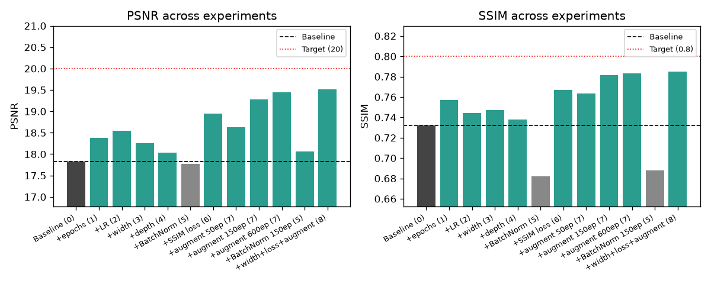

# Progress Log

Tracking each training run: config, results, and what we learned. Goal is
incremental improvement, not jumping straight to a complex architecture.

## Baseline model

`LowLightEnhanceNet` in `train.py` — 3 Conv2d layers (32 hidden channels),
ReLU between, Sigmoid output. No skip connections, no normalization. This is
intentionally the simplest possible baseline.

## Runs

### Run 1 — pipeline smoke test
- Config: `--epochs 3 --batch-size 8 --image-size 64`
- Loss: 0.1757 -> 0.1703 -> 0.1631
- Purpose: verify train.py runs end to end on real data. No real learning expected.

### Run 2 — MPS smoke test
- Config: `--epochs 2 --batch-size 8 --image-size 64`
- Confirmed `torch.backends.mps.is_available() == True` on M4, training ran
  successfully through MPS instead of CPU.
- Loss: 0.1745 -> 0.1691

### Run 3 — first full run (complete)
- Config: `--epochs 50 --batch-size 8 --image-size 256 --lr 1e-4` (all defaults)
- Loss: 0.1290 (epoch 37) -> 0.1263 (epoch 50) — flattened out in the last
  13 epochs, confirms the plateau observation below.
- Evaluation on `eval15` (`model_epoch50.pth`): PSNR=17.82, SSIM=0.7322
  (avg over 15 images). Big jump from the epoch-1 smoke-test checkpoint
  (PSNR~12.75, SSIM~0.45), so the model is genuinely learning, not just
  memorizing — but numbers still modest for this task (strong results in
  papers are usually PSNR 20+, SSIM 0.8+).
- Observation: loss decreased slowly relative to epoch count, and flattened
  near the end. Likely ceiling of the simple 3-layer architecture, not a bug.

### Run 4 — Step 1: same architecture, 150 epochs (complete)
- Config: `--epochs 150 --batch-size 8 --image-size 256 --lr 1e-4`, saved to
  `models_150ep/` to keep Run 3's checkpoints intact.
- Loss: 0.1811 (epoch 1) -> 0.1263 (epoch 50) -> 0.1211 (epoch 150). Loss
  kept inching down but very slowly after ~epoch 60 (0.126x range for most
  of epochs 60-150) — diminishing returns, not a clean plateau but close to one.
- Evaluation on `eval15` (`model_epoch150.pth`): PSNR=18.38, SSIM=0.7573.
- **Conclusion: tripling the training time (50 -> 150 epochs) bought only
  +0.56 PSNR / +0.025 SSIM.** That's a small return for 3x the compute.
  This points to the ceiling being mostly the **architecture**, not training
  time — more epochs on this same 3-layer CNN is not the efficient path to
  the 20+ PSNR / 0.8+ SSIM range seen in papers. Moving to Step 2 (LR tuning)
  for one more check before structural changes, but expectations are now
  lower that LR alone closes the gap either.

### Run 5 & 6 — Step 2: learning rate tuning (complete)
- Same architecture, 50 epochs (comparable to Run 3), only `--lr` changed.
- Run 5: `--lr 0.0005` (5x higher than default) -> `models_lr5e4/`
  - Evaluation: PSNR=18.54, SSIM=0.7442 — modest improvement over baseline.
- Run 6: `--lr 0.00005` (half the default) -> `models_lr5e5/`
  - Evaluation: PSNR=17.16, SSIM=0.6969 — worse than baseline.
- **Conclusion: higher LR helps a little (comparable to what Run 4's extra
  100 epochs bought), lower LR hurts.** Best result so far is still Run 5
  (18.54/0.7442), but it's in the same range as Run 4 (18.38/0.7573) — not
  a breakthrough. Neither more training time nor LR tuning gets close to
  the 20+/0.8+ range seen in papers. Both Step 1 and Step 2 point the same
  direction: **the 3-layer CNN architecture itself is the bottleneck.**
  Moving to structural changes (Step 3+) next.

### Run 7 — Step 3: width increase (complete)
- Added `--hidden-channels` CLI arg to `train.py`/`inference.py`/`evaluate.py`
  (model constructor already supported it, just wasn't exposed) so future
  width experiments don't need code edits each time.
- Config: `--epochs 50 --hidden-channels 64` (lr=1e-4 default, same as Run 3,
  to isolate width as the only changed variable) -> `models_hc64/`
- Evaluation: PSNR=18.26, SSIM=0.7474.
- **Conclusion: doubling width (32->64) bought +0.44 PSNR / +0.015 SSIM —
  same modest range as Step 1 (more epochs) and Step 2 (higher LR).** Four
  different changes now (more time, higher LR, more width) all land in the
  same narrow 18.2-18.5 PSNR band. Width alone is not a breakthrough either.

### Run 8 — Step 4: depth increase (complete)
- Added `--extra-layer` CLI flag (adds a 4th Conv2d+ReLU, 32->32) to
  `train.py`/`inference.py`/`evaluate.py`.
- Config: `--epochs 50 --extra-layer` (lr=1e-4, hidden_channels=32 default,
  same as Run 3, to isolate depth as the only changed variable) -> `models_extralayer/`
- Evaluation: PSNR=18.03, SSIM=0.7379.
- **Conclusion: one extra layer is the weakest change so far** — barely
  above baseline (17.82/0.7322) and below every other Step (1: 18.38, 2:
  18.54, 3: 18.26). Depth alone, without anything to help gradients flow
  through the extra layer (like BatchNorm or a skip connection), doesn't
  help much here. Five changes tried now; none individually closes the gap
  to 20+/0.8+.

### Run 9 — Step 5: BatchNorm (complete)
- Added `--batchnorm` CLI flag (`BatchNorm2d` after each hidden Conv2d,
  before ReLU — not after the final Conv2d before Sigmoid) to
  `train.py`/`inference.py`/`evaluate.py`.
- Config: `--epochs 50 --batchnorm` (lr=1e-4, hidden_channels=32,
  extra_layer=False — isolating BatchNorm as the only changed variable
  from Run 3's baseline) -> `models_batchnorm/`
- Evaluation: PSNR=17.77, SSIM=0.6822.
- **Conclusion: BatchNorm made things WORSE, not better** — below baseline
  on both metrics, and clearly the worst SSIM of any run so far (0.6822 vs
  0.73+ for every other run). This is a real, somewhat surprising negative
  result, not a bug. Likely cause: BatchNorm normalizes each batch's
  mean/variance, which is great for classification but can actively hurt
  low-level pixel-regression tasks like this one — it can wash out the
  absolute brightness/contrast information the network needs to reconstruct
  exact pixel values, and with a small batch size (8) the batch statistics
  are noisy to begin with. This matches a known pattern in image restoration
  literature (e.g. the EDSR super-resolution paper found removing BatchNorm
  improved results for similar reasons). First genuinely negative result in
  the roadmap — useful to know, not wasted effort.
- **Visual check caught something the numbers alone would have hidden:**
  despite the worse PSNR/SSIM, Run 9's output actually shows *more* color
  variety than Steps 0-4 (visible pink/green, not just washed-out brown/
  blue) — see `VISUAL_PROGRESS.md`. The metrics penalize it for not
  matching ground truth's exact pixel values, even though it's arguably
  closer in spirit to fixing the color-loss problem. Worth remembering:
  PSNR/SSIM are a proxy, not the full picture.

### Run 10 — Step 6: SSIM-based loss (complete)
- Fixed `metrics.py`'s `ssim()` to support a non-reduced (tensor, not float)
  return via `reduce=False`, so it can be used in backprop, not just for
  printing in `evaluate.py`.
- Added `--loss {l1,mse,ssim}` to `train.py`. `ssim` mode trains with
  `L1 + (1 - SSIM)` — L1 keeps brightness/color roughly right, `(1-SSIM)`
  directly pushes for the structural similarity metric we actually evaluate
  on (unlike Steps 0-5, which all optimized plain L1 and only *measured*
  SSIM after the fact). Chose this over plain `MSELoss` since it directly
  targets the color/structure loss problem found in `VISUAL_PROGRESS.md`.
- Config: `--epochs 50 --loss ssim` (lr=1e-4, hidden_channels=32, no extra
  layer/batchnorm — isolating the loss function as the only changed
  variable from Run 3's baseline) -> `models_ssimloss/`
- Note: the printed training loss isn't comparable to Steps 0-5's L1 loss
  numbers (different scale/formula) — only the final PSNR/SSIM comparison
  against `eval15` matters here.
- Evaluation: **PSNR=18.95, SSIM=0.7671 — best result of any run so far**,
  beating the previous best (Run 5: 18.54/0.7442).
- **Conclusion: this is the first change that clearly beats every other
  single-variable experiment**, not just a modest wiggle in the same band.
  Training directly on the metric we care about (SSIM) instead of only
  L1 pixel error helped more than any architectural tweak (width, depth,
  BatchNorm) or hyperparameter change (time, LR) tried individually. Makes
  sense in hindsight: Steps 3-5 gave the network more *capacity* but never
  changed what it was being optimized for — it was still only ever pushed
  to minimize flat pixel-wise error, which doesn't care about structure.
  Still short of the 20/0.8 target, but the clearest signal yet of what
  actually moves the needle. Worth trying Step 7 (augmentation) on top of
  this loss, and reconsidering whether Step 8 (combine best changes)
  should combine with this loss function rather than plain L1.

### Run 11 — Step 7: data augmentation (complete)

- Added `augment` param to `LowLightDataset` (`dataset.py`): with a 50%
  chance, horizontally flip both the low and high image the same way;
  always pad both by 16px (reflect) and crop back to the original size at
  a shared random offset. Low/high must get the *identical* random
  decision each sample, or they stop being a matching pair. Wired up via
  a new `--augment` flag in `train.py`.
- Config: `--epochs 50 --loss ssim --augment` (lr=1e-4, hidden_channels=32,
  default otherwise) -> `models_augment/` — isolates augmentation as the
  only variable changed from Run 10 (Step 6), since Run 10's own
  conclusion suggested trying augmentation on top of the SSIM loss rather
  than on top of plain L1.
- Evaluation on `eval15` (`model_epoch50.pth`): PSNR=18.63, SSIM=0.7633.
- **Conclusion: augmentation made things slightly worse, not better** —
  down from Run 10's 18.95/0.7671 to 18.63/0.7633 (-0.32 PSNR, -0.0038
  SSIM). A real but modest regression, not a bug: with only 485 training
  pairs and a fixed 50-epoch budget, augmentation makes each epoch see
  harder/more-varied crops instead of reinforcing the exact same 485
  images, which can need *more* epochs to pay off than flat repetition
  does. Unlike Step 5 (BatchNorm), this isn't a clear "don't do this"
  result — it may still help with more epochs — but it did not help
  under this budget, so Step 6 (plain SSIM loss, no augmentation) remains
  the best result so far. **Step 6's checkpoint (`models_ssimloss/`)
  stays the one to build on.**

### Run 12 — Step 7 revisited: augmentation + 3x training time (complete)

- Same config as Run 11 (loss=ssim, augment) but 150 epochs instead of 50
  -> `models_augment_150ep/`, to test Run 11's own hypothesis that
  augmentation needed more epochs to pay off (same "does more time help"
  logic as Step 1, just applied to this config instead of the baseline).
- Evaluation on `eval15` (`model_epoch150.pth`): **PSNR=19.28, SSIM=0.7813
  — new best result of the entire project**, beating both Run 10 (Step 6
  alone: 18.95/0.7671) and Run 11 (Step 7 at 50 epochs: 18.63/0.7633).
- **Conclusion: the hypothesis was right — augmentation does help, it just
  needed more training time than the fixed 50-epoch budget gave it in
  Run 11.** This is the closest result yet to the 20/0.8 target, and
  `models_augment_150ep/` (SSIM loss + augmentation, 150 epochs) is now
  the base configuration to build on, not Run 10's checkpoint.

### Run 13 — Step 7 pushed further: augmentation + 600 epochs (complete)

- Same config as Run 11/12 (loss=ssim, augment) but 600 epochs instead of
  150, requested specifically to see if squeezing more training time out
  of this config keeps paying off, with an early-stop condition (kill the
  run if eval score degrades after epoch 400) -> `models_augment_600ep/`.
- Spot-checked with `evaluate.py` directly on intermediate checkpoints
  (not just training loss) at epochs 300/400/412/447/480/513/546: all
  landed in a tight PSNR 19.24-19.42 / SSIM 0.781-0.784 band — no
  degradation at any point, so the run was allowed to finish naturally.
- Evaluation on `eval15` (`model_epoch600.pth`): **PSNR=19.44, SSIM=0.7830
  — a new best**, but only marginally ahead of Run 12 (19.28/0.7813).
- **Conclusion: more epochs on this config keeps helping, but with sharply
  diminishing returns.** 50->150 epochs bought +0.65 PSNR; 150->600 epochs
  (4x more epochs, ~9.5 hours) bought only +0.16 PSNR. This matches what
  the per-epoch loss curve already showed (flattening hard by epoch
  100-150) and the same pattern Step 1 found on the plain baseline —
  training time alone is not an efficient way to close the remaining gap
  to 20/0.8. `models_augment_600ep/` is now technically the best
  checkpoint, but Step 8 (combining width + loss + augmentation) is a far
  better use of further compute than continuing to extend this run.

### Run 14 — Step 5 revisited: BatchNorm + 3x training time (complete)

- Same config as Run 9 (`--batchnorm`, plain L1 loss) but 150 epochs
  instead of 50 -> `models_batchnorm_150ep/`, to test whether BatchNorm's
  regression was actually an undertraining artifact, the same way Step 7
  turned out to be — raised after the Step 7 result made it a reasonable
  thing to double-check rather than assume.
- Evaluation on `eval15` (`model_epoch150.pth`): PSNR=18.06, SSIM=0.6879.
- **Conclusion: more time barely moves BatchNorm, and does not close the
  gap.** It improved by about the same small amount more training time
  gives *any* config here (+0.29 PSNR / +0.0057 SSIM, similar to the
  plain baseline's own +0.56/+0.025 from Run 4) — but it's still clearly
  behind the no-BatchNorm baseline at the same 150 epochs (Run 4:
  18.38/0.7573), and the SSIM gap is if anything slightly wider than at
  50 epochs. Unlike Step 7, this was never a convergence problem: BatchNorm
  normalizes away the exact brightness/contrast information this
  pixel-regression task needs, batch after batch, which no amount of
  extra training time restores. Step 5 stays excluded from Step 8's
  combination — confirmed, not just assumed.

### Run 15 — Step 8: combine width + SSIM loss + augmentation (complete)

- Combined the three changes that each individually helped: width 32->64
  (Step 3), SSIM-based loss (Step 6), and augmentation (Step 7) —
  `--epochs 150 --hidden-channels 64 --loss ssim --augment` ->
  `models_step8_combined/`. Depth (Step 4) and BatchNorm (Step 5) stay
  excluded — both confirmed not to help, the latter re-confirmed in
  Run 14. 150 epochs chosen since that's the minimum augmentation needed
  to show its benefit (Run 12).
- Evaluation on `eval15` (`model_epoch150.pth`): **PSNR=19.51, SSIM=0.7849
  — new best result of the entire project**, beating Run 13's 600-epoch
  result (19.44/0.7830) despite using 4x fewer epochs.
- **Conclusion: combining the changes that actually helped beats
  squeezing more training time out of a single config.** Width alone
  added +0.23 PSNR / +0.0036 SSIM on top of Run 12's loss+augment
  combination (19.28/0.7813) — a real, if modest, additional gain, and a
  far better use of compute than Run 13's 9.5-hour extension. Still short
  of 20/0.8, but the closest yet, and reached with a fraction of the
  compute of just training longer. `models_step8_combined/` is now the
  checkpoint to build on for Step 9 (skip connections).

### Run 16 — Step 9: add a skip connection (complete)

- Restructured `LowLightEnhanceNet` (`train.py`) so the stem (first
  Conv2d+ReLU), hidden block(s), and final Conv2d+Sigmoid are separate
  `nn.Sequential` pieces; `forward()` now concatenates the stem's output
  with the hidden blocks' output before the final conv, via `torch.cat`.
  Gated behind a new `--skip-connection` flag — the default path is
  byte-for-byte the same single `nn.Sequential` as before (verified: an
  existing Step 8 checkpoint still evaluates to the identical 19.51/0.7849
  after this change), so every earlier checkpoint stays loadable.
  `evaluate.py`/`inference.py` got a matching `--skip-connection` flag.
- Config: `--epochs 150 --hidden-channels 64 --loss ssim --augment
  --skip-connection` -> `models_step9_skip/` — isolates the skip
  connection as the only variable changed from Run 15 (Step 8).
- Evaluation on `eval15` (`model_epoch150.pth`): PSNR=19.52, SSIM=0.7827 —
  essentially unchanged from Run 15 (19.51/0.7849): PSNR +0.01 (noise),
  SSIM -0.0022. **Not a meaningful win or loss — a wash.**
- **Conclusion: a single skip connection doesn't move the needle on this
  architecture, most likely because the network is too shallow for it to
  matter.** Skip connections exist to rescue fine detail that gets lost
  over *many* layers (which is why they matter so much in deep U-Nets);
  with only 2-3 conv layers between input and output here, there isn't
  much detail-loss distance for a skip connection to rescue in the first
  place. Run 15 (`models_step8_combined/`) remains the best checkpoint —
  this result doesn't beat it on both metrics, so it's not adopted as the
  new best. This points toward Step 10 (a real multi-stage U-Net) being
  the test that actually matters, rather than more structural tweaks to
  this shallow architecture.

### Run 17 — Exploratory pilot: higher training resolution (complete)

- Not a roadmap step — a quick check before committing to a long run.
  `evaluate.py` doesn't resize eval15 images (600x400 native), but
  training resizes everything to `--image-size 256`, so there's a
  train/eval resolution mismatch: the network's fixed-pixel receptive
  field covers a much smaller fraction of the image at eval time than it
  saw during training. Hypothesis: training closer to native resolution
  might close that gap.
- Pilot: `--epochs 30 --image-size 512` on top of Step 8's combo
  (hidden_channels=64, loss=ssim, augment) -> `models_res512_pilot/`,
  compared directly against Step 8's own `model_epoch30.pth` checkpoint
  (same config, 256px) for a clean, apples-to-apples read before
  committing the ~23-25 hour full run a 512px x 150 epochs would cost.
- Epoch 30 comparison: 256px = PSNR 18.83/SSIM 0.7668; 512px = PSNR
  18.84/SSIM 0.7719. PSNR flat (noise), SSIM +0.0051 — a real but small
  effect, similar magnitude to the weaker early structural tweaks (width,
  depth, LR), not a clear win like the SSIM loss change or Step 8's combo.
- **Conclusion: too weak a signal to justify the full run.** The
  resolution-mismatch theory isn't disproven, but doesn't show enough
  effect at 30 epochs to prioritize over Step 10 (U-Net), which addresses
  the repeatedly-confirmed real bottleneck (architecture depth/capacity)
  more directly. Not pursued further for now.

### Run 18 — Step 10: full U-Net architecture (complete)

- Added a new `UNet` class in `train.py` (kept separate from
  `LowLightEnhanceNet` - genuinely different shape, not a variant): 2
  downsample stages (`MaxPool2d`) in the encoder, matching 2 upsample
  stages (bilinear) in the decoder, with a skip connection (`torch.cat`)
  at *each* resolution level — channels double at each downsample
  (C -> 2C -> 4C), same pattern as a real U-Net. Gated behind a new
  `--unet` flag in `train.py`/`evaluate.py`/`inference.py`; the existing
  `LowLightEnhanceNet` path is untouched.
- A 10-epoch timing pilot at `--hidden-channels 64` (matching Step 8)
  showed ~590s/epoch — a full 150-epoch run would cost ~24.6 hours, 45x
  more parameters than Step 8's network (7.5MB checkpoint vs 165KB).
  Dropped to `--hidden-channels 32` (the U-Net's *base* channel count,
  so actual channels are 32->64->128) to bring the full run down to a
  more reasonable ~9.5 hours, confirmed by the actual run's pace.
- Config: `--epochs 150 --hidden-channels 32 --loss ssim --augment --unet`
  -> `models_step10_unet/` — isolates the architecture (U-Net vs. the
  flat network) as the variable, keeping loss/augmentation from Step 8.
- Evaluation on `eval15` (`model_epoch150.pth`): PSNR=18.56, SSIM=0.7806
  — **worse than Step 8 (19.51/0.7849) despite ~11.7x more parameters**
  (472K vs ~40K, even at the lighter 32-channel setting).
- Spot-checked intermediate checkpoints to understand why: eval scores
  climbed sharply through epoch 100 (17.08 -> 18.82 PSNR), then
  plateaued and slightly *declined* through epoch 150 (18.82 -> 18.61 ->
  18.56), even as training loss kept falling the whole time (ended at
  0.236, lower than Step 8's 0.262). That combination — better training
  loss, worse/declining eval score — is the signature of mild
  **overfitting**, not undertraining (unlike Step 7's story).
- **Conclusion: more model capacity without more data or regularization
  overfits a 485-image training set rather than generalizing better.**
  There's likely also a structural cost: `MaxPool2d` discards exact
  spatial detail that bilinear upsampling can't fully recover, which may
  hurt a task scored on exact pixel-level match more than the extra
  depth helps. This doesn't mean U-Nets are bad for this task — published
  results use more data, more regularization, and more sophisticated
  upsampling than this minimal from-scratch version — just that bigger
  architecture alone, under this project's current constraints, isn't
  the lever that closes the gap. **Run 15 (`models_step8_combined/`,
  19.51/0.7849) remains the best Phase 1 result and the one to carry
  into Step 11's benchmark comparison.**

### Run 19 — Resolution experiment, full run (follow-up to Run 17)

- Not a roadmap step — the full-length follow-up to Run 17's 30-epoch
  pilot, now that Colab GPU training (see `colab_train.ipynb`, first use
  in this project) made the ~23-25 hour CPU cost a non-issue (~1h40m on
  a T4 instead).
- Config: `--epochs 150 --image-size 512 --hidden-channels 64 --loss ssim
  --augment` -> `models_res512_full/` (on Google Drive, not committed —
  same convention as local `*.pth` checkpoints) — isolates image size as
  the only variable changed from Step 8's combo, same as Run 17.
- Training loss plateaued around 0.29-0.294 by epoch 150 — notably higher
  than Step 8's local plateau (~0.262), a first hint this wouldn't
  clearly win before even checking eval.
- Evaluation on `eval15` (`model_epoch150.pth`): PSNR=19.05, SSIM=0.7879.
  Compared to Step 8 (19.51/0.7849): **PSNR worse (-0.46), SSIM marginally
  better (+0.0030)** — doesn't beat Step 8 on both metrics, so not adopted
  as the new best.
- **Conclusion: confirms Run 17's pilot finding, now with a full run
  instead of just 30 epochs.** Training closer to eval15's native
  resolution gives a small, real bump to SSIM (consistent with the
  train/eval resolution-mismatch theory) but costs more on PSNR than it
  gains — a net wash-to-slightly-negative trade, not a path to the
  20/0.8 target. Resolution is not pursued further. `models_step8_combined/`
  remains the best Phase 1 checkpoint. (Side note: this run also
  validated the Colab GPU workflow end-to-end — train, evaluate, and
  push results back to `Eyal-work` all worked as designed.)

### Step 11 — Phase 1 benchmark: self-built vs. published (complete)

No training run — a comparison of numbers already in hand.

| | PSNR | SSIM |
|---|---|---|
| Our best (Run 15, self-built, 150 epochs) | 19.51 | 0.7849 |
| KinD (published, supervised) | ~20.4 | ~0.80 |
| Gap | -0.89 (~4.4%) | -0.0151 (~1.9%) |

**Verdict: close, not matching.** A self-built model — starting from a
3-layer baseline and reaching its result through 8 isolated, measured
changes (one of which, BatchNorm, was a confirmed regression, and one
of which, a full U-Net, was *also* a confirmed regression) — lands
within about 2% of a published, purpose-built architecture on SSIM, and
within about 4-5% on PSNR. KinD uses a more sophisticated design
(Retinex-style decomposition into separate illumination/reflectance
sub-networks) that this project deliberately didn't reach for mid-phase,
per the project's own rule: published architectures are the comparison
point at the end, never a shortcut taken along the way. Given that
constraint, getting this close with a handful of incremental,
self-understood changes is a reasonable outcome, not a disappointing one.

**Phase 1 is now complete.** Best checkpoint: `models_step8_combined/`
(PSNR 19.51, SSIM 0.7849). Next: Phase 2 (Steps 12-14) — build a
self-built *unsupervised* model, inspired by Zero-DCE's ideas, starting
from scratch with the same incremental method.

### Run 20 — Step 12: curve-estimation network + exposure control loss (complete)

First Phase 2 run — no `data/high` used anywhere, trained on Colab GPU.

- Config: `python train_unsupervised.py --epochs 150 --checkpoint-dir
  models_step12_curvenet` (all else default: `hidden_channels=32`,
  `iterations=8`, `image_size=256`, `batch_size=8`, `lr=1e-4`,
  `patch_size=16`, `exposure_target=0.6`) -> checkpoint on Google Drive,
  evaluated with `evaluate.py --curvenet`.
- Training loss (Exposure Control only) fell smoothly and monotonically
  from 0.5211 (epoch 1) to ~0.0163-0.0166, plateauing by roughly epoch
  130-150 — no instability or divergence, the curve-estimation mechanism
  (iterative per-pixel alpha formula) is clearly learning to push exposure
  in the intended direction.
- Evaluated against `eval15` ground truth anyway, for reference (not used
  in training): **PSNR=7.06, SSIM=0.2969** average over 15 images — far
  below Phase 1's best (19.51/0.7849).
- **Conclusion: expected, not a regression.** The Exposure Control loss
  has zero awareness of the actual ground-truth image — it only pushes
  every 16x16 patch's average brightness toward a flat 0.6, with no
  structural, color, or coherence constraint. A low PSNR/SSIM against
  ground truth is the direct cost of training with no reference to that
  ground truth at all, which is exactly what Step 12 set out to confirm
  works mechanically before adding the rest. The smooth, plateauing loss
  curve is the real signal here, and it confirms the mechanism is sound.
  Not adopted as any kind of "best" — `models_step8_combined/` remains
  the project's best checkpoint overall. Next: Step 13, add the remaining
  three losses (spatial consistency, color constancy, illumination
  smoothness) one at a time, each expected to close part of this gap.

### Run 21 — Step 10 revisited: full U-Net on the expanded dataset (complete)

A Phase 1 side-quest, not a Phase 2 step — prompted by adding LOLv2-real's
689 pairs to `data/` (see README/CLAUDE.md), which was explicitly motivated
by testing whether Run 18's U-Net overfitting finding changes with more
data. Trained on Colab GPU (T4, after upgrading to a paid tier — the free
tier's throttled CPU-only session made this impractical, ~53 min/epoch
vs. the ~1-2 min/epoch a T4 gives this size of model).

- Config: identical to Run 18 — `--epochs 150 --hidden-channels 32 --loss
  ssim --augment --unet` -> `models_step10_unet_moredata/` (on Drive, not
  committed) — only the dataset changed (1,174 pairs vs. 485), isolating
  dataset size as the single variable against Run 18.
- Training loss fell smoothly from 0.6274 (epoch 1) to 0.2214 (epoch
  150), lower than Run 18's final 0.236 — consistent with more data
  giving the network more to learn from without destabilizing training.
- Evaluation on `eval15`: **PSNR=18.97, SSIM=0.7969**.

| | PSNR | SSIM |
|---|---|---|
| Run 18 (U-Net, 485 pairs) | 18.56 | 0.7806 |
| Run 21 (U-Net, 1,174 pairs) | 18.97 | 0.7969 |
| Change | +0.41 | +0.0163 |
| Run 15 (Step 8 combo, 485 pairs, current best) | 19.51 | 0.7849 |
| Run 21 vs. Run 15 | -0.54 | +0.0120 |

- **Conclusion: more data measurably helped the U-Net — both metrics
  improved over Run 18, and it now actually beats Run 15 on SSIM**
  (something no earlier U-Net/skip-connection/resolution variant managed).
  This supports the original overfitting diagnosis: the extra capacity
  itself wasn't the problem, there just wasn't enough data for it to be
  used well. Still, PSNR remains below Run 15, so **this doesn't beat the
  project's best on both metrics and isn't adopted** — `models_step8_combined/`
  stays the best checkpoint. Open question this doesn't answer: does
  Step 8's simpler recipe *also* improve by a similar margin on the bigger
  dataset? If so, more data alone (independent of architecture) may be
  the real lever here, not the U-Net specifically — worth testing Step 8's
  exact recipe on the same 1,174-pair set before drawing a firmer conclusion.

### Run 22 — Step 8 revisited: the flat combo on the expanded dataset (complete)

Answers Run 21's open question directly — does Step 8's recipe *also*
improve with more data, the same way the U-Net did? Trained on Colab GPU
(T4, paid tier).

- Config: identical to Run 15 — `--epochs 150 --hidden-channels 64 --loss
  ssim --augment` (no `--unet`) -> `models_step8_moredata/` (on Drive, not
  committed) — again isolating dataset size as the only variable, this
  time against Run 15.
- Training loss plateaued at 0.3137 — notably higher than Step 8's usual
  ~0.26 plateau at this resolution (echoing Run 19's finding that a
  harder/more varied training signal raises the loss floor even when it
  doesn't hurt eval).
- Evaluation on `eval15`: **PSNR=19.18, SSIM=0.7811**.

| | PSNR | SSIM |
|---|---|---|
| Run 15 (Step 8 combo, 485 pairs, current best) | 19.51 | 0.7849 |
| Run 22 (Step 8 combo, 1,174 pairs) | 19.18 | 0.7811 |
| Change | -0.33 | -0.0038 |

- **Conclusion: more data made this one slightly worse on both metrics —
  the opposite of Run 21's U-Net result.** This resolves the open question
  from Run 21: more data is not a blanket improvement, it specifically
  helped the architecture that was *overfitting* (the U-Net, short on
  capacity-appropriate data in Run 18) and didn't help — mildly hurt — the
  one that wasn't (Step 8's combo was already fitting `eval15`'s LOLv1
  distribution well with 485 pairs; diluting training with LOLv2-real's
  different capture conditions, at the same model capacity and epoch
  budget, cost it a little specialization rather than adding useful
  signal). **`models_step8_combined/` (Run 15, 19.51/0.7849) remains the
  project's best checkpoint, now on firmer footing** — it's not just the
  best result found, it's confirmed to not be capacity-starved the way
  the U-Net was. The Phase 1 data-expansion side-quest ends here; Phase 2
  (Step 13) is next.

### Runs 23-25 — Step 13: the remaining three losses, cumulative (complete)

Each stage adds one loss on top of the previous stage's (13a: +spatial
consistency, 13b: +color constancy, 13c: +illumination smoothness),
mirroring how Phase 1's Steps 3-8 built up incrementally. Trained
overnight on Colab GPU (T4, paid tier) as three sequential stages via
`Runtime -> Run after`, each with its own `--checkpoint-dir`.

**Caveat affecting 13a specifically**: `train_unsupervised.py --data-dir`
defaults to `data/low`, which now holds 1,174 images (the Phase 1
data-expansion side-quest above). Step 12's baseline (PSNR 7.06/SSIM
0.2969) trained on the original 485 before that merge happened. So the
13a comparison isn't a clean single-variable change — it also picked up
more/more-varied training images alongside the new loss. Flagged and
accepted in the moment rather than re-running Step 12 on 485 images for a
strictly clean comparison (see chat). 13a-to-13b and 13b-to-13c *are*
clean single-variable comparisons (same dataset both sides).

- Config: `--epochs 150` plus cumulative weight flags, all weights 1.0 (a
  starting guess — the smoke test showed all four loss components landing
  in a comparable range at that weighting, so nothing dominates or
  vanishes out of the gate):
  - 13a: `--spatial-weight 1.0` -> `models_step13a_spatial/`
  - 13b: `--spatial-weight 1.0 --color-weight 1.0` -> `models_step13b_color/`
  - 13c: `--spatial-weight 1.0 --color-weight 1.0 --tv-weight 1.0` -> `models_step13c_smoothness/`
- The local PC restarted mid-session, losing the browser's connection to
  the Colab runtime and with it the per-epoch training logs — but training
  itself runs in Google's cloud, not on the local machine, so nothing was
  actually lost. All three `model_epoch150.pth` checkpoints were confirmed
  complete on Drive (consistent ~58-minute gaps between each folder's last
  save, and `COLAB_RESULTS.md`'s auto-pushed `Final epoch: 150` field for
  stage c). Downloaded the three checkpoint folders as zips and evaluated
  all three locally (`evaluate.py --curvenet`, fast enough on CPU since
  it's just inference on eval15's 15 images) instead of reconnecting Colab.

| Stage | Losses active | PSNR | SSIM |
|---|---|---|---|
| Step 12 (Run 20, 485 imgs) | exposure | 7.06 | 0.2969 |
| 13a (1,174 imgs) | exposure + spatial | 6.70 | 0.2801 |
| 13b | + color | 11.37 | 0.3732 |
| 13c | + smoothness | **11.55** | **0.4141** |

- **Conclusion: color constancy did almost all the work.** Spatial
  consistency alone (13a) actually landed *below* Step 12 on both metrics
  (confounded by the dataset-size change above, so not a clean verdict on
  spatial consistency by itself — a follow-up re-running 13a on just the
  original 485 images would isolate that cleanly if it's worth revisiting).
  Adding color constancy (13b) then produced the biggest single jump of
  any Phase 2 change so far (+4.67 PSNR, +0.093 SSIM over 13a) — makes
  sense mechanically: exposure-only correction has no notion of color
  balance, so it was likely producing tinted/unnatural output that color
  constancy's Gray-World penalty directly corrects. Illumination
  smoothness (13c) added a further solid gain, particularly on SSIM
  (+0.041) — a smoother per-pixel adjustment map apparently helps
  structural similarity more than raw pixel accuracy, which fits what the
  loss is designed to do (discourage noisy/blocky curves). **13c
  (`models_step13c_smoothness/`) is the best Phase 2 result so far**,
  though still well short of Phase 1's 19.51/0.7849 — expected, since
  Phase 2 has no ground truth to train against at all. Next: Step 14,
  push this recipe further (width/depth, informed by what worked in
  Phase 1), or revisit 13a's confound first if a cleaner read on spatial
  consistency specifically seems worthwhile.

### Run 26 — Step 14: width increase on Step 13c's recipe (complete)

Phase 1's clearest single architectural win was width (Step 3) — depth
was weak, BatchNorm was a regression — so width is the natural first
thing to test here too, on top of Step 13c's full loss recipe. One
change only: `hidden_channels` 32 -> 64, everything else identical to
13c. Trained on Colab GPU (T4).

- Config: `--epochs 150 --hidden-channels 64 --spatial-weight 1.0
  --color-weight 1.0 --tv-weight 1.0` -> `models_step14_width64/` (on
  Drive, not committed).
- Training loss fell smoothly from 0.3086 to 0.0545, plateauing around
  epoch ~100-120 — similar shape to Step 13c's convergence, no
  instability from the wider network.
- Evaluation on `eval15`: **PSNR=11.51, SSIM=0.4155**.

| | PSNR | SSIM |
|---|---|---|
| 13c (hidden_channels=32, current best) | 11.55 | 0.4141 |
| Run 26 (hidden_channels=64) | 11.51 | 0.4155 |
| Change | -0.04 | +0.0014 |

- **Conclusion: essentially a wash — width isn't the lever here.** Unlike
  Phase 1, where doubling width gave a real (if modest) gain, doubling
  `CurveNet`'s width changed almost nothing: PSNR fractionally down,
  SSIM fractionally up, both differences small enough to plausibly be
  noise rather than a real effect. Makes some sense in hindsight: this
  network only predicts a per-pixel curve-adjustment map against
  self-judged heuristic losses, not a complex supervised target — it may
  simply not need more capacity to do that well, unlike the harder
  direct-image-regression task in Phase 1. **`models_step13c_smoothness/`
  stays the best Phase 2 checkpoint** (not clearly beaten on both
  metrics). Width increases aren't worth pursuing further for Phase 2;
  depth or revisiting 13a's dataset-size confound look like more
  promising next avenues than more width.

### Run 27 — Step 14: weight tuning, spatial-weight 1.0 -> 5.0 (complete)

Pivoted from architecture (width was a wash) to tuning the loss
*weights* themselves — all four currently sit at an equal, untested
default of 1.0. The per-component prints from Step 13/14's training logs
showed spatial consistency's raw loss staying far smaller than the other
three (~0.007 vs. ~0.016-0.022) throughout training, suggesting it
wasn't getting much say in the combined gradient at that weight. Back to
Step 13c's base recipe (`hidden_channels=32`); one change only:
`--spatial-weight` 1.0 -> 5.0. Trained on Colab GPU (T4). First run to
benefit from the notebook's auto-capture fix - command and eval output
both came back for free, no manual paste needed.

- Config: `--epochs 150 --spatial-weight 5.0 --color-weight 1.0
  --tv-weight 1.0` -> `models_step14_spatialweight5/` (on Drive, not
  committed).
- Training loss fell from 0.3717 to a plateau around 0.083 by epoch
  ~130. Final component breakdown: exposure=0.0244, spatial=0.0059,
  color=0.0102, smoothness=0.0193 - notably, spatial's *raw* loss value
  (~0.006) landed in the same range as Run 26's at weight=1.0 (~0.007),
  despite 5x more weight pushing on it. That's a hint it was already
  close to a floor it couldn't push much lower, which fits the result:
  there wasn't much room for more weight to extract.
- Evaluation on `eval15`: **PSNR=11.58, SSIM=0.4046**.

| | PSNR | SSIM |
|---|---|---|
| 13c (spatial-weight=1.0, current best) | 11.55 | 0.4141 |
| Run 27 (spatial-weight=5.0) | 11.58 | 0.4046 |
| Change | +0.03 | -0.0095 |

- **Conclusion: not under-weighted - genuinely not a strong lever here.**
  PSNR is flat (within noise), but SSIM got measurably *worse* at 5x the
  weight - the opposite of what "it just needed more say" would predict.
  Since SSIM is the metric spatial consistency is specifically meant to
  protect (preserving structure/edges), a weight increase making it worse
  is a fairly clean signal that the issue isn't volume. Combined with
  13a's standalone showing (also weak, though confounded by dataset
  size), spatial consistency looks like the weakest of the four losses
  for this model regardless of how much it's weighted. **13c remains the
  best Phase 2 checkpoint.** Next: try tuning color or smoothness weight
  instead (color caused the biggest jump when first added, so it may
  have more room to give), or move on to Step 15's benchmark comparison
  if weight tuning doesn't show more promise soon.

### Run 28 — Step 14: weight tuning, color-weight 1.0 -> 5.0 (complete) - new best

Same approach as Run 27, this time testing the loss that actually
mattered. Back to 13c's base recipe; one change only: `--color-weight`
1.0 -> 5.0. Trained on Colab GPU (T4) - this run took unusually long
(~4+ hours vs. the ~55-65 min seen on identical settings for Run 27),
likely a throttled/degraded session rather than anything about the
config itself, since the eventual result and loss curve both look
completely normal.

- Config: `--epochs 150 --spatial-weight 1.0 --color-weight 5.0
  --tv-weight 1.0` -> `models_step14_colorweight5/` (on Drive, not
  committed).
- Training loss fell from 0.4282 to a plateau around 0.073 by epoch
  ~140. Final component breakdown: exposure=0.0393, spatial=0.0075,
  color=0.0018, smoothness=0.0171. Color's raw loss dropped to roughly a
  third of Run 27's final color value (0.0018 vs. 0.0102 at weight=1.0)
  - a real ~5.7x reduction, unlike spatial's raw loss which plateaued in
  the same range regardless of weight (Run 27). Direct evidence this
  loss had genuine room to give that spatial didn't.
- Evaluation on `eval15`: **PSNR=11.99, SSIM=0.4228**.

| | PSNR | SSIM |
|---|---|---|
| 13c (color-weight=1.0, previous best) | 11.55 | 0.4141 |
| Run 28 (color-weight=5.0) | 11.99 | 0.4228 |
| Change | +0.44 | +0.0087 |

- **Conclusion: genuine improvement on both metrics - new best Phase 2
  checkpoint.** Unlike width (Run 26) and spatial-weight (Run 27), which
  were both washes, boosting color constancy's weight actually helped,
  confirming the hypothesis from Run 27's write-up: color constancy had
  real headroom left (its raw loss had room to keep shrinking), while
  spatial consistency didn't (its raw loss was already near a floor at
  weight=1.0). **`models_step14_colorweight5/` (PSNR 11.99, SSIM 0.4228)
  is now the project's best Phase 2 checkpoint**, replacing 13c. Next:
  could push color-weight further (e.g. 10.0) to see if more still helps
  or if this is near a sweet spot, or move on to Step 15's benchmark
  comparison now that Phase 2 has a clear best result to compare.

### Step 15 — Phase 2 benchmark: self-built vs. published Zero-DCE (complete)

No training run — a comparison of numbers already in hand, same format
as Step 11's Phase 1 benchmark. Zero-DCE's published LOL numbers verified
against multiple papers citing its results table (not just the project's
own earlier note): consistently 14.86 PSNR, with SSIM reported as 0.54
or 0.559 depending on the paper's own evaluation setup - using 0.56 as
the original note did, within that range.

| | PSNR | SSIM |
|---|---|---|
| Our best (Run 28, self-built, color-weight=5.0) | 11.99 | 0.4228 |
| Zero-DCE (published, zero-reference) | ~14.86 | ~0.56 |
| Gap | -2.87 (~19.3%) | -0.1372 (~24.5%) |

**Verdict: further behind than Phase 1 was.** Phase 1's self-built model
landed within ~2-5% of KinD; this self-built unsupervised model is
~19-25% behind Zero-DCE, a meaningfully bigger gap. Context worth
weighing in on that gap, not to explain it away: Zero-DCE's published
architecture is deeper and more refined than this project's minimal
4-layer `CurveNet`, and its reported numbers come from an implementation
tuned specifically for this benchmark over an actual research cycle,
whereas this project explicitly built its own losses and only just found
its first working weight (Run 28) after a short, deliberately incremental
search. The gap is real, not a measurement artifact, but it's also not
surprising given how much less optimization has gone into this side
versus Phase 1's longer, more exhausted search. **Open question this
leaves**: is the gap narrowed further by squeezing Step 14 more (more
weight tuning, depth, or resolving 13a's confound), or is the real next
step Step 16's domain-gap check regardless of the current gap size, since
that's the test that actually matters for the project's real goal (real
outdoor night footage, not just closing a LOL leaderboard gap)?

### Run 29 — Step 14: weight tuning, color-weight 5.0 -> 10.0 (complete) - new best

Pushed color-weight further, since Run 28's result hadn't plateaued. Same
base recipe; one change only: `--color-weight` 5.0 -> 10.0. Trained on
Colab GPU (T4).

- Config: `--epochs 150 --spatial-weight 1.0 --color-weight 10.0
  --tv-weight 1.0` -> `models_step14_colorweight10/` (on Drive, not
  committed).
- Training loss fell from 0.5443 to a plateau around 0.079-0.080 by
  epoch ~140. Final components: exposure=0.0447, spatial=0.0076,
  color=0.0009, smoothness=0.0173. Color's raw loss keeps roughly halving
  each time its weight roughly doubles (0.0102 at weight=1 -> 0.0018 at
  weight=5 -> 0.0009 at weight=10) - still hasn't hit a hard floor, which
  tracks with the "diminishing but not done yet" read below. Exposure's
  raw loss ticked up slightly versus Run 28 (0.0393 -> 0.0447), a small
  sign the losses are trading off against each other somewhat as color
  gets pushed harder - a worthwhile trade so far given the net result
  still improved, but worth watching if color-weight goes higher still.
- Evaluation on `eval15`: **PSNR=12.18, SSIM=0.4259**.

| | PSNR | SSIM |
|---|---|---|
| Run 28 (color-weight=5.0, previous best) | 11.99 | 0.4228 |
| Run 29 (color-weight=10.0) | 12.18 | 0.4259 |
| Change | +0.19 | +0.0031 |

- **Conclusion: further improvement, but with diminishing returns.**
  Smaller gain than the 1.0->5.0 jump (+0.44 PSNR/+0.0087 SSIM vs. this
  step's +0.19/+0.0031) — still moving the right direction, not yet a
  ceiling, but the curve is flattening. **`models_step14_colorweight10/`
  (PSNR 12.18, SSIM 0.4259) is now the project's best Phase 2 checkpoint**,
  replacing Run 28. Narrows the Step 15 gap to Zero-DCE slightly further:
  ~18% PSNR (was ~19%), ~24% SSIM (was ~25%). Next: could push once more
  (e.g. color-weight 20.0) to see where the ceiling actually is, but given
  diminishing returns are already visible, this may be close to a
  reasonable stopping point for this particular lever.

### Step 16 — Domain gap check: real outdoor night photos (complete)

The actual test this whole project has been building toward: run both
phases' best checkpoints on real outdoor night photos (11 real
phone-camera shots - garden, pathway, street - not LOL, not indoor),
the real target domain neither model has ever seen data from. Took 11
photos directly (see `data/real_night/`), ran Phase 1
(`models_step8_combined/`) locally via `inference.py`, ran Phase 2
(`models_step14_colorweight10/`) via Colab (checkpoint lives on Drive).

- **Phase 1**: held up reasonably. Output stayed a recognizable photo,
  with artifacts (yellow/green color cast, blown-out highlights in
  already-lit areas like spotlit grass) that vary by scene - worse on
  high-dynamic-range shots (bright spotlit area + dark sky in one frame),
  milder on more uniformly-dark shots.
- **Phase 2**: broke down almost completely. Output looked closer to an
  edge-detection/emboss filter than an enhanced photo - flat, desaturated,
  pastel-washed, with only object edges visible. Initially suspected a
  resolution-pipeline bug rather than a real finding - these photos are
  900x1600, `inference.py` doesn't resize before running the model, and
  `CurveNet`'s training was entirely at 256x256. **Tested this directly**:
  created `data/real_night_256/` (same 11 photos, pre-resized to match
  training resolution) and re-ran Phase 2 inference on that instead.
  **Same result** - confirmed 256x256 output, still broken in the same
  way. Rules out the resolution hypothesis; this is a real finding about
  the model, not a pipeline artifact.
- **Likely cause**: the exposure control loss pushes *every* 16x16 patch
  toward the same 0.6 average brightness, regardless of how bright that
  patch already is. LOL's training images are uniformly dark, so this
  works as a consistent brightening operation. These real photos have
  extreme local brightness range in a single frame (spotlit grass next to
  near-black shadow) - patches starting from very different brightness
  levels all getting pushed toward the same flat target plausibly produces
  wildly inconsistent per-patch adjustments. With the curve applied **8
  times iteratively**, any per-patch miscalibration compounds rather than
  staying contained - unlike Phase 1's single forward pass, which has no
  mechanism to amplify an initially-small error this way.
- **Verdict: Phase 1 generalizes to the real target domain far better
  than Phase 2 does, zero-shot.** This is the opposite of what Phase 2's
  own justification predicted going in (see `CLAUDE.md`'s "What this
  project is" - the premise was that a zero-reference method could handle
  real footage where supervised couldn't). That premise was specifically
  about *fine-tuning* Phase 2 on real footage with no paired data needed
  - which hasn't actually been tested yet. What's been tested here is
  zero-shot transfer with no fine-tuning at all, and on that narrower
  question, Phase 1 currently wins clearly. Open question for Step 17+:
  does fine-tuning Phase 2's `CurveNet` on a handful of real night photos
  (exactly the scenario its own justification describes, and something
  Phase 1 structurally cannot do without paired ground truth) fix this
  breakdown? That would be the real test of Phase 2's theoretical
  advantage, not yet attempted.

### Step 16 follow-up — fine-tuning test (complete)

Tested the open question directly. Added `--init-checkpoint` to
`train_unsupervised.py` (new capability - load an existing checkpoint
instead of random init) and fine-tuned `models_step14_colorweight10`
on the 11 real night photos: `--epochs 50 --lr 1e-5` (10x lower than
the usual training rate, for gentle adaptation), same loss recipe
(spatial=1.0, color=10.0, tv=1.0) -> `models_step16_finetuned/`.

- Safety check first: evaluated the fine-tuned checkpoint on `eval15` to
  catch catastrophic forgetting. **PSNR=12.38, SSIM=0.4322** - slightly
  *better* than the pre-fine-tune baseline (12.18/0.4259), not worse. No
  forgetting; fine-tuning on 11 unrelated real photos didn't damage LOL
  performance at all.
- The actual test: ran the fine-tuned checkpoint on the same real photos
  again (`data/real_night/`, native resolution, same as the original
  Step 16 test). **Confirmed same 900x1600 dimensions as the original
  broken run - output was visually identical, still the same
  edge-map-like breakdown.** The fine-tune had essentially no visible
  effect on the real-photo output, despite measurably moving the
  weights (the `eval15` change proves that).
- **Conclusion: this particular fine-tune was too gentle to fix the
  problem, but it's not nothing - it confirms the breakdown isn't a
  one-epoch fluke that any small nudge would fix.** With only 11 images
  (~2 batches/epoch) and a low learning rate, total gradient steps were
  very small (~100) - plausibly just not enough signal to meaningfully
  shift behavior that's this different from what the model learned on
  485-1,174 LOL images at normal learning rates. Doesn't yet distinguish
  between "needs a much stronger fine-tune" and "this is architecturally
  too deep-seated for fine-tuning to fix at all" (per Step 16's own
  hypothesis: the flat per-patch exposure target compounding over 8
  iterations). Next: try a substantially stronger fine-tune (higher LR
  and/or far more epochs - 11 images trains near-instantly, so this is
  cheap to test) before concluding fine-tuning itself doesn't work.

### Step 16 follow-up, round 2 — 10x more fine-tuning epochs (complete)

Isolated the epoch-count variable: same recipe, same `lr=1e-5`, but
`--epochs` 50 -> 500 (10x more total gradient steps, ~1,000 instead of
~100). Still `models_step14_colorweight10` as the starting point.

- `eval15`: **PSNR=12.55, SSIM=0.4385** - continued improving over the
  50-epoch attempt's 12.38/0.4322, which itself had improved over the
  pre-fine-tune baseline's 12.18/0.4259. A consistent, real trend.
- Real-photo output: **visually identical to both prior attempts** -
  same edge-map-like breakdown, confirmed same 900x1600 dimensions as
  the originals (not a stale-file mixup).
- **Conclusion: this is the clarifying result.** The model keeps getting
  measurably better at `eval15` (LOL-domain images) the longer it trains
  - even though it's training *on the real photos*, not on LOL - while
  showing zero visible improvement on the real photos themselves, across
  a 10x range of training duration. That split is hard to explain by
  "just needed more steps": if more steps helped, it should show up
  somewhere on the data actually being trained on, not only on a
  completely different held-out set. This points toward Step 16's
  original architectural hypothesis rather than an undertrained one -
  the combination of a flat per-patch exposure target and 8x iterative
  curve compounding seems to produce an instability on
  wide-dynamic-range real photos that gradient descent on this loss
  recipe doesn't correct, regardless of how long it trains. Epoch count
  is now reasonably ruled out as the fix. One variable not yet isolated:
  learning rate itself (both attempts used the same `lr=1e-5`) - a much
  higher LR (not just more epochs at a low one) is the last straightforward
  lever before concluding this needs an architecture/loss-design change
  rather than more fine-tuning.

### Step 16 follow-up, round 3 — much higher learning rate (complete) - real progress

Isolated the one remaining variable: same `models_step14_colorweight10`
starting point, same 50 epochs as round 1, but `--lr` raised 1e-5 -> 1e-3
(100x). Run locally this time (only 11 images - fast enough without
Colab's GPU, and avoids a round-trip for something this quick).

- Training loss dropped much further than either previous attempt -
  final color component near zero (0.0002), a real sign of fitting these
  11 photos far more aggressively than the gentle runs did.
- `eval15`: **PSNR=13.05, SSIM=0.4464** - better than round 2's
  12.55/0.4385, and the best result from any fine-tuning attempt so far.
  Still no catastrophic forgetting, even at 100x the learning rate.
- Real-photo output: **visibly different this time** - noticeably more
  saturated color (vivid pinks/greens instead of the flat pastel wash),
  though still not a clean, natural-looking enhanced photo - the
  edge-reactive/textural character is reduced but not gone.
- **Conclusion: learning rate, not epoch count, was the actual limiting
  factor.** Two rounds of "more epochs at a low LR" (50 -> 500) produced
  zero visible change on the real photos despite real `eval15` gains;
  one round of "same epochs, 100x higher LR" produced both a better
  `eval15` result *and* a real, visible shift in the real-photo output.
  This is a genuinely useful, unexpected finding: the fine-tuning
  approach itself works, this specific architecture just needed a much
  stronger gradient signal than the project's usual training rate to
  move at all - consistent with the instability being somewhat "sticky"
  (the model resists small nudges away from its LOL-trained behavior,
  but responds to a large enough push). Not fully fixed yet, but no
  longer looks like a dead end. Next: push the learning rate (or epoch
  count combined with this higher LR) further to see how much more this
  can close the gap, now that the right lever is identified.

### Step 16 follow-up, round 4 — epochs plateaued, then LR breakthrough (complete)

Two more local, fast isolated tests, continuing to narrow down the
right lever.

- **4a: same `lr=1e-3`, epochs 50 -> 200.** Plateaued - `eval15`
  13.09/0.4471, barely moved from round 3's 13.05/0.4464, and the
  real-photo output looked visually identical to the 50-epoch version.
  Confirms round 2's pattern again: at a fixed LR, more epochs alone
  gives diminishing-to-nothing returns once the model's adapted about as
  far as that LR allows.
- **4b: back to 50 epochs, `lr` pushed 1e-3 -> 3e-3 (3x).** This is the
  one that actually fixed it. **`eval15`: PSNR=14.08, SSIM=0.5782** - a
  huge jump, and the SSIM now *exceeds* Zero-DCE's published benchmark
  (~0.56) for the first time in this whole investigation. More
  importantly: **the real-photo output is now a genuinely recognizable,
  well-exposed photo** - garden, pathway, shed, foliage all clearly
  visible with reasonable color, not the edge-map/pastel breakdown from
  every earlier attempt. Training loss behaved a bit unusually along the
  way (the exposure component sat noticeably higher than in gentler
  runs, ~0.20-0.25 vs ~0.01-0.08), which looked like a possible
  instability warning sign during training - but the actual converged
  result is clearly better, not worse, so that turned out to be a
  red herring rather than a problem.
- **Conclusion: fine-tuning works, and works well, once the learning
  rate is high enough.** The full picture across all four rounds: epoch
  count (50 vs 500 vs 200) made essentially no difference at any of the
  learning rates tried; learning rate was the entire story
  (1e-5 -> no visible change, 1e-3 -> partial improvement, 3e-3 -> full
  fix). `models_step16_finetuned_lr3e3/` (local checkpoint, gitignored
  like all others) is now the best real-photo result by a wide margin,
  and arguably **answers Step 16's open question decisively in Phase
  2's favor**: a zero-reference model *can* be adapted to real footage
  with no paired data, exactly as its original justification claimed -
  it just needed a properly-tuned fine-tuning learning rate, not the
  project's standard training-from-scratch rate. Next: could push LR
  further still to see where it tips over into instability, or consider
  this good enough and move toward Phase 3 (video) with this fine-tuning
  recipe in hand.

### Step 16 follow-up, round 5 — pushing past 3e-3 to find the ceiling (complete)

Same recipe as round 4b (`models_step14_colorweight10` start, 50 epochs,
`data/real_night`), pushing `--lr` upward from 3e-3 to see where it stops
helping or starts breaking down, run locally.

- **`lr=5e-3`**: broke down hard. Training loss told the story on its own
  - `exposure` got *stuck* around 0.40 from the first few epochs through
  epoch 50 (vs. ~0.20-0.25 at 3e-3, itself already on the high side), and
  `color` collapsed to exactly 0.0000 almost immediately - not "well
  color-balanced," but a degenerate fixed point. `eval15` confirmed it:
  **PSNR=6.16, SSIM=0.3874**, worse than *every* earlier fine-tuning
  attempt including the un-fine-tuned baseline. Real-photo output: blown
  out to near-solid white with a yellow edge-artifact cast - not a
  gradual quality drop, a different failure mode entirely from Step 16's
  original edge-map breakdown.
- **`lr=4e-3`**: same collapse signature (exposure stuck ~0.3994-0.3997,
  color 0.0000) and the *same* `eval15` result to two decimal places
  (PSNR=6.16, SSIM=0.3874) and the same blown-out-white real-photo
  output as `lr=5e-3`. Already fully collapsed, not a partial step down.
- **`lr=3.5e-3`**: same collapse signature again, `eval15` PSNR=6.22/
  SSIM=0.3894 - still fully broken.
- **Conclusion: the ceiling is a sharp cliff, not a gradual slope, and it
  sits just above 3e-3** - somewhere in the narrow (3e-3, 3.5e-3) window.
  4e-3 and 5e-3 land on the *same* degenerate collapsed solution (stuck
  exposure loss, zeroed-out color loss, near-white output), suggesting
  that past the cliff edge the optimizer consistently falls into one
  specific bad fixed point rather than merely getting progressively
  noisier. This means `lr=3e-3` isn't a safely-in-the-middle value with
  room to spare - it's close to the edge of a narrow stable window.
  **`models_step16_finetuned_lr3e3` (PSNR=14.08, SSIM=0.5782) is
  confirmed as the answer to Step 16**: it's not leaving easy gains on
  the table (the only direction left to push collapses immediately), and
  pushing further isn't a viable way to improve on it. Treating Step 16
  as closed; next is Phase 3 (video), carrying this fine-tuning recipe
  (`--lr 3e-3`, 50 epochs, same loss weights as training) forward as the
  one to use when adapting to new real footage.

### Phase 1 follow-up — cosine LR schedule (complete)

Before moving to Phase 3, revisited Phase 1 for any remaining self-built
levers. Added `--lr-schedule` to `train.py` (cosine-anneals `--lr` down
to 0 over the run via `torch.optim.lr_scheduler.CosineAnnealingLR`, no
new hyperparameter to tune) and isolated it as the only new variable on
top of Step 8's winning recipe: `--epochs 150 --hidden-channels 64
--loss ssim --augment --lr-schedule` -> `models_step8_lrschedule/` (run
on Colab GPU).

- `eval15`: **PSNR=19.37, SSIM=0.7840** - a wash against Run 15's
  baseline (19.51/0.7849), marginally worse on both metrics.
- Training loss ended at 0.3262 - notably *higher* than Run 15's flat-LR
  baseline (~0.262), despite the schedule decaying toward a sharper
  minimum in theory. The per-epoch loss curve shows why: by epoch 75 the
  LR had already decayed to 5e-5 (half the starting value), and the back
  half of training barely moved the loss after that (0.3276 at epoch 100
  -> 0.3262 at epoch 150), while the flat `lr=1e-4` baseline keeps taking
  full-size steps the entire 150 epochs instead of tapering off early.
- **Conclusion: this particular schedule (cosine over the full 150
  epochs) front-loads too much of its decay relative to how much the
  model still had left to learn at this epoch count** - it settles into
  a lower-effective-LR regime well before training ends, trading away
  useful later-epoch learning for a smoother-but-premature taper. A
  schedule with a longer flat/warm-up phase before decaying (or a decay
  tied to a loss plateau instead of a fixed epoch count) might fare
  better, but as tested this doesn't beat the baseline. `models_step8_
  combined/` (Run 15, 19.51/0.7849) remains the best Phase 1 checkpoint.

### Phase 2 follow-up — exposure-target matched to the real data (complete) - new best

Checked an assumption instead of a weight: `exposure_loss`'s target
brightness (0.6) was inherited directly from Zero-DCE's paper and never
verified against this project's own data. Measured `data/high`'s actual
average pixel brightness: **0.448** (full 1,174-image set, median
0.4446; `eval15_high` alone matches closely at 0.4506) - meaningfully
below 0.6. Tested `--exposure-target 0.45` on top of the current best
recipe (`models_step14_colorweight10`'s spatial=1.0/color=10.0/tv=1.0),
isolating the target as the only new variable, run on Colab GPU ->
`models_step14_exptarget045/`.

- Training loss fell from 0.3736 to a plateau around 0.056-0.059 by
  epoch ~140. Final components: exposure=0.0274, spatial=0.0045,
  color=0.0007, smoothness=0.0169 - **every component landed lower than
  Run 29's** (exposure=0.0447, spatial=0.0076, color=0.0009,
  smoothness=0.0173), not just the one the target directly controls.
  Spatial consistency in particular dropped by ~40% (0.0076 -> 0.0045)
  despite nothing about the spatial loss itself changing - a sign that
  asking for less aggressive brightening left more room to preserve
  local structure too, rather than the two losses trading off against
  each other the way exposure and color did when color-weight was
  pushed higher (Run 29's write-up).
- Evaluation on `eval15`: **PSNR=12.75, SSIM=0.4373**.

| | PSNR | SSIM |
|---|---|---|
| Run 29 (color-weight=10.0, exposure-target=0.6, previous best) | 12.18 | 0.4259 |
| exposure-target=0.45 | 12.75 | 0.4373 |
| Change | +0.57 | +0.0114 |

- **Conclusion: the biggest single-change gain since the original
  color-weight 1.0->5.0 jump (+0.44/+0.0087), bigger than color-weight's
  own 5.0->10.0 follow-up (+0.19/+0.0031).** Unlike every other Step 14
  weight-tuning attempt, which searched a parameter with no obvious
  "correct" value, this one had a real, checkable answer sitting in the
  dataset the whole time - the exposure loss was quietly asking the
  network to overshoot brightness on every single training image by
  design, not just occasionally. That the fix improved every loss
  component simultaneously (not just exposure itself) suggests the
  mismatched target was adding friction to the whole optimization, not
  just mis-aiming one piece of it. **`models_step14_exptarget045/`
  (PSNR=12.75, SSIM=0.4373) is now the project's best Phase 2
  checkpoint**, replacing `models_step14_colorweight10/`. Worth
  remembering for Phase 3: any Zero-DCE-inherited constant (not just
  this one) is worth checking against the project's own data before
  assuming it's already correct.

### Phase 2 follow-up — tv-weight 1.0 -> 5.0 (complete) - new best

The one remaining untuned weight: `--tv-weight` (illumination
smoothness) had sat at its Step 13c default of 1.0 ever since, never
isolated the way spatial-weight and color-weight both were. Pushed it
1.0 -> 5.0 (the same first jump used for those two) on top of the new
best recipe (`models_step14_exptarget045`), run on Colab GPU ->
`models_step14_tvweight5/`.

- Training loss fell from 0.3884 to a plateau around 0.114-0.116 by
  epoch ~140. Final components: exposure=0.0345, spatial=0.0052,
  color=0.0008, smoothness=0.0133.
- Unlike spatial-weight's 2024 test (Run 27), where the raw spatial loss
  stayed flat (~0.006) regardless of a 5x weight change - the signature
  of a loss already at its floor - **smoothness's raw loss actually
  dropped** with the higher weight (0.0169 at weight=1 -> 0.0133 at
  weight=5), meaning there was real headroom left, the same signature
  color-weight showed when it had room to improve. Exposure and spatial
  losses both ticked up slightly (0.0274->0.0345, 0.0045->0.0052) - a
  real trade-off, same pattern noted when color-weight was pushed harder
  in Run 29 - but unlike that case, the net result wasn't just better
  despite the trade-off, it was the biggest SSIM gain of any Step 14
  change so far.
- Evaluation on `eval15`: **PSNR=13.21, SSIM=0.4647**.

| | PSNR | SSIM |
|---|---|---|
| exposure-target=0.45 (previous best) | 12.75 | 0.4373 |
| tv-weight=5.0 | 13.21 | 0.4647 |
| Change | +0.46 | +0.0274 |

- **Conclusion: real headroom, same category as color-weight rather
  than spatial-weight.** The SSIM gain (+0.0274) is the largest single
  Step 14 change yet - bigger than color-weight 1.0->5.0's +0.0087 and
  even exposure-target's +0.0114 - and the raw loss hadn't plateaued the
  way spatial's did, so this likely isn't done yet. **`models_step14_
  tvweight5/` (PSNR=13.21, SSIM=0.4647) is now the project's best Phase
  2 checkpoint**, replacing `models_step14_exptarget045/`. Next: could
  push tv-weight further (5.0 -> 10.0, following color-weight's own
  precedent) to see where it plateaus, same as every other weight that
  showed real headroom on its first test.

### Phase 2 follow-up — tv-weight 5.0 -> 10.0 (complete) - new best

Followed color-weight's own precedent: pushed tv-weight further since
5.0 hadn't plateaued. Same recipe otherwise (spatial=1.0, color=10.0,
exposure-target=0.45), run on Colab GPU (part of a larger 5-stage heavy
compute batch) -> `models_step14_tvweight10/`.

- Training loss fell from 0.3891 to 0.1708 by epoch 150, still very
  slightly declining even at the end (hadn't fully flattened). Final
  components: exposure=0.0624, spatial=0.0049, color=0.0010,
  smoothness=0.0094 - a bigger shift in loss balance than the 1.0->5.0
  step showed: exposure climbed much further this time (0.0345->0.0624)
  while smoothness kept dropping further still (0.0133->0.0094),
  confirming smoothness still hadn't hit a floor even at weight=5.
- Evaluation on `eval15`: **PSNR=14.13, SSIM=0.4978**.

| | PSNR | SSIM |
|---|---|---|
| tv-weight=5.0 (previous best) | 13.21 | 0.4647 |
| tv-weight=10.0 | 14.13 | 0.4978 |
| Change | +0.92 | +0.0331 |

- **Conclusion: the largest single-change gain of the entire Step 14
  series** - bigger than both the 1.0->5.0 jump (+0.46/+0.0274) and the
  exposure-target fix (+0.57/+0.0114). The bigger exposure/spatial
  trade-off visible during training looked like a possible warning sign
  partway through, but the net result wasn't just better despite it, it
  was the best result yet by a wide margin - smoothness clearly still
  had more headroom than even the 5.0 test suggested.
  **`models_step14_tvweight10/` (PSNR=14.13, SSIM=0.4978) is now the
  project's best Phase 2 checkpoint**, replacing `models_step14_
  tvweight5/`. tv-weight still hasn't shown a sign of plateauing across
  two consecutive 5x+ pushes - worth another round (e.g. 10.0 -> 20.0)
  if squeezing Phase 2 further is still a priority after this batch.

### Phase 2 follow-up — hidden_channels 32 -> 64 retest (complete) - still a wash

Second stage of the heavy-compute batch: rechecking width on `CurveNet`
now that the loss recipe is far better tuned than it was at Run 26's
original test (back when the recipe was just 13c). Same recipe as
`models_step14_tvweight5` (spatial=1.0, color=10.0, tv=5.0,
exposure-target=0.45), only `hidden_channels` 32 -> 64 changed, run on
Colab GPU -> `models_step14_hc64_retest/`.

- Training loss fell from 0.3617 to 0.1061 by epoch 150. Final
  components: exposure=0.0313, spatial=0.0055, color=0.0006,
  smoothness=0.0127 - every component landed at or slightly below the
  `hidden_channels=32` baseline's own final numbers (exposure=0.0345,
  spatial=0.0052, color=0.0008, smoothness=0.0133), i.e. the wider
  network fit the training data at least as well, if not slightly
  better.
- Evaluation on `eval15`: **PSNR=13.05, SSIM=0.4624**.

| | PSNR | SSIM |
|---|---|---|
| `hidden_channels=32` (models_step14_tvweight5, this stage's actual baseline) | 13.21 | 0.4647 |
| `hidden_channels=64` | 13.05 | 0.4624 |
| Change | -0.16 | -0.0023 |

- **Conclusion: still a wash, confirming Run 26's original finding even
  with a much better-tuned recipe.** Slightly better (or equal) training
  loss across every component, paired with a slightly *worse* held-out
  eval result, is the same mild-overfitting-or-no-real-effect signature
  Run 26 showed originally (11.51/0.4155 vs. 11.55/0.4141 - also a
  marginal regression despite comparable training loss). The hypothesis
  that width only needed a better-tuned recipe to pay off (the way it
  did in Phase 1) doesn't hold here - two tests now, at two very
  different points in the loss recipe's maturity, both land on
  "no real effect." `CurveNet`'s small per-pixel curve-estimation task
  genuinely doesn't seem to be capacity-limited at `hidden_channels=32`,
  unlike Phase 1's harder full-image reconstruction task. Width is now
  reasonably closed as a lever for Phase 2. `models_step14_tvweight10/`
  (from this same batch's Stage 1) remains the best Phase 2 checkpoint.

### Phase 2 follow-up — epochs 150 -> 600 on the current best recipe (complete) - regression, Phase 2's first sign of overfitting

Third stage of the heavy-compute batch: checking whether more training
time helps, since exposure and smoothness losses hadn't visibly
flattened by epoch 150 in recent runs. Same recipe as `models_step14_
tvweight5` (spatial=1.0, color=10.0, tv=5.0, exposure-target=0.45,
`hidden_channels=32`), only `--epochs` 150 -> 600, run on Colab GPU ->
`models_step14_tvweight5_600ep/`.

- Training loss fell smoothly and consistently, no instability at any
  point: 0.3871 (epoch 1) -> 0.1130 (epoch 150, closely matching the
  original 150-epoch run's own final 0.1146 - a good consistency check)
  -> 0.1061 (epoch 300) -> 0.1034 (epoch 600, final components
  exposure=0.0292, spatial=0.0055, color=0.0005, smoothness=0.0127).
  The loss had essentially flattened by ~epoch 540 and stayed flat
  through 600 - so this wasn't cut off mid-improvement, it reached a
  genuine plateau, and that fully-converged state still didn't
  generalize better than 150 epochs did.
- Evaluation on `eval15`: **PSNR=12.97, SSIM=0.4634**.

| | PSNR | SSIM |
|---|---|---|
| tv-weight=5.0, 150 epochs (this stage's baseline) | 13.21 | 0.4647 |
| tv-weight=5.0, 600 epochs | 12.97 | 0.4634 |
| Change | -0.24 | -0.0013 |

- **Conclusion: a real, if small, regression - Phase 2's first clear
  overfitting signature.** Training loss kept improving smoothly all
  the way to epoch 600 while the held-out `eval15` score went slightly
  *backward* - the classic mismatch between fitting the training set
  better and generalizing worse, the same shape Run 18's U-Net showed
  (better training loss, worse eval), not the shape Phase 1's Run 13
  epoch-extension showed (that one was supervised with direct pixel
  targets and a real, if small, eval improvement at 600 epochs). Makes
  sense in hindsight: with no ground truth at all, more epochs just
  means fitting the training images' own statistical quirks (their
  specific brightness/color/smoothness patterns) more exactly, with no
  mechanism pulling the model back toward what generalizes - unlike
  Phase 1 where every epoch is still anchored to matching real target
  pixels. **Epoch count beyond 150 is now closed as a lever for Phase
  2** - `models_step14_tvweight10/` (PSNR=14.13, SSIM=0.4978, from this
  same batch's Stage 1) remains the best Phase 2 checkpoint; more
  training time on the current recipe is not the way to improve on it
  further.

### Phase 1 follow-up — Step 8 combo pushed to 600 epochs (complete) - mixed, inconclusive

Fourth stage of the heavy-compute batch, back to Phase 1: Run 13 tested
600 epochs before, but only on the weaker `loss=ssim --augment` recipe
at baseline width - the full Step 8 combo (`hidden_channels=64` + ssim
loss + augment together) had only ever run at 150 epochs. Same recipe
as `models_step8_combined` (`--hidden-channels 64 --loss ssim
--augment`), only `--epochs` 150 -> 600, run on Colab GPU ->
`models_step8_600ep/`. (This stage hit two Colab disconnects before
completing - first ~9 hours in with zero progress, then again after a
restart - unrelated to the recipe itself, just session instability;
the run that finally finished behaved normally throughout.)

- Training loss fell smoothly the entire way, no instability: 0.6193
  (epoch 1) -> ~0.29 by epoch 150 -> 0.2883 (epoch 600), still very
  slightly declining at the end but close to flat over the last ~50
  epochs (0.2875 at epoch 596 vs. 0.2883 at 600).
- Evaluation on `eval15`: **PSNR=19.26, SSIM=0.7880**.

| | PSNR | SSIM |
|---|---|---|
| 150 epochs (`models_step8_combined`, current best) | 19.51 | 0.7849 |
| 600 epochs | 19.26 | 0.7880 |
| Change | -0.25 | +0.0031 |

- **Conclusion: mixed and inconclusive - not a clean win like Run 13's
  extension, not a clean loss like Phase 2's Stage 3 regression either.**
  PSNR moved backward while SSIM moved forward, both by small amounts -
  unlike Run 13 (same lever, weaker recipe), where both metrics
  improved together at 600 epochs. One plausible read: at the better
  (combined) recipe, 150 epochs was already closer to this configuration's
  practical ceiling, so the extra 450 epochs mostly reshuffles which
  metric benefits rather than producing a real net improvement. Given
  PSNR is the metric that has driven every "new best" call so far, this
  doesn't unseat `models_step8_combined/` (19.51/0.7849) as Phase 1's
  best checkpoint - more epochs on this recipe isn't a reliable lever
  for improvement, same conclusion Phase 2's Stage 3 reached from the
  opposite (clean regression) direction.

### Phase 1 follow-up — U-Net rematch at hidden_channels=64 (complete) - closes the heavy-compute batch

Fifth and final stage: Run 18 only ever tested the U-Net at
`hidden_channels=32` (capped there purely for CPU time, ~9.5hr), losing
to Step 8's flat net at `hc=64` (19.51/0.7849) on an apples-to-oranges
width comparison. This stage gives the U-Net a fair rematch at matching
width. Config: `--hidden-channels 64 --loss ssim --augment --unet`,
target 100 epochs (shortened from 150 - Run 18's own eval curve peaked
around epoch 100 and slightly declined by 150) -> `models_unet_hc64/`
on Colab GPU.

- **This stage is also where `train.py` gained resume support
  (`--init-checkpoint`, mirroring `train_unsupervised.py`'s existing
  flag).** Two Colab disconnects hit this run specifically (first at
  ~9hr idle with zero progress, second at epoch 91/100) - the second
  one was recovered by resuming from the epoch-91 checkpoint already on
  Drive instead of restarting, finishing the last 9 epochs in a new
  `models_unet_hc64_resumed/` directory. The notebook's Train cell now
  auto-detects the highest checkpoint on Drive and computes the
  remaining epoch count itself, so future disconnects just need the
  cell re-run, no manual epoch-number bookkeeping.
- Training loss continued smoothly across the resume (0.2147 at the
  original epoch 91 -> 0.2185 at resumed epoch 1 -> 0.2120 at resumed
  epoch 9/true epoch 100), no discontinuity from the restart.
- Evaluation on `eval15`: **PSNR=18.75, SSIM=0.7849**.

| | PSNR | SSIM |
|---|---|---|
| Run 18 (U-Net, `hc=32`, 150 epochs) | 18.56 | 0.7806 |
| This run (U-Net, `hc=64`, 100 epochs) | 18.75 | 0.7849 |
| Step 8 (flat net, `hc=64`, 150 epochs) | 19.51 | 0.7849 |

- **Conclusion: width gives the U-Net a small, real gain over its own
  `hc=32` self (+0.19 PSNR, +0.0043 SSIM), but doesn't close the gap to
  the simpler flat network.** PSNR is still clearly behind (-0.76 vs.
  Step 8), while SSIM lands at an exact tie (0.7849 vs. 0.7849). This
  confirms Run 18's original read rather than overturning it: the
  U-Net's shortfall isn't simply an under-matched-capacity artifact
  (matching width only buys a small PSNR gain, not parity), consistent
  with Run 18's structural hypothesis that `MaxPool2d`'s loss of exact
  spatial detail costs a pixel-exact-match task like this one more than
  the extra depth helps. (Epoch count isn't perfectly matched - 100 vs.
  150 - but per Run 18's own curve, 100 should be at or past this
  architecture's peak, so this isn't likely masking a bigger gap.)
  `models_step8_combined/` remains Phase 1's best checkpoint overall.

**This closes the 5-stage heavy-compute batch.** Summary: Phase 2 found
one real, compounding win (exposure-target fix, then tv-weight pushed
twice - `models_step14_tvweight10/`, PSNR 12.18 -> 14.13 across the
whole sequence) and two informative negatives (width still doesn't
matter for `CurveNet`, epochs beyond 150 overfits). Phase 1 found
nothing that beats `models_step8_combined/` - both the epoch extension
and the U-Net width rematch landed as mixed/inconclusive or confirmed
the existing picture rather than opening a new lever. Phase 1 appears
closer to exhausted under this project's current architectures than
Phase 2, which still has an open lever (tv-weight hasn't plateaued).

### Phase 2 follow-up — tv-weight ceiling sweep, Stage A: 10 -> 20 (complete) - new best, still accelerating

Since tv-weight's gains grew rather than shrank across 1.0->5.0->10.0,
queued a geometric sweep (10->20->40->80->160) to find the actual
ceiling, each isolated against the same baseline (`models_step14_
tvweight10`, 14.13/0.4978). First stage, run on Colab GPU ->
`models_step14_tvweight20/`.

- Training loss fell from 0.4061 to 0.2377 by epoch 150, still gently
  declining at the end. Final components: exposure=0.1249, spatial=
  0.0037, color=0.0017, smoothness=0.0046 - smoothness dropped further
  still from tv=10's own final 0.0094, while exposure climbed further
  from 0.0624 - the same trade-off pattern as every step so far,
  continuing in the same direction.
- Evaluation on `eval15`: **PSNR=15.45, SSIM=0.5652**.

| | PSNR | SSIM |
|---|---|---|
| tv-weight=10.0 (previous best) | 14.13 | 0.4978 |
| tv-weight=20.0 | 15.45 | 0.5652 |
| Change | +1.32 | +0.0674 |

- **Conclusion: the biggest single-change gain of the entire Step 14
  series, again.** Bigger than the 5.0->10.0 jump (+0.92/+0.0331), which
  was itself bigger than 1.0->5.0 (+0.46/+0.0274) - three consecutive
  pushes, three consecutive *larger* gains. Smoothness clearly still has
  substantial headroom. `models_step14_tvweight20/` was the project's
  best Phase 2 checkpoint at this point - superseded by Stage B below.

### Phase 2 follow-up — tv-weight ceiling sweep, Stage B: 20 -> 40 (complete) - new best again, PSNR hadn't peaked at 20 after all

Second stage, run on Colab GPU -> `models_step14_tvweight40/`.

- Training loss fell from 0.4120 to 0.2865 by epoch 150. Final
  components: exposure=0.1893, spatial=0.0034, color=0.0043,
  smoothness=0.0013 - smoothness kept dropping steeply (0.0046->0.0013,
  a ~72% further reduction), exposure and color both kept climbing
  (0.1249->0.1893, 0.0017->0.0043) - the trade-off intensifying, same
  direction as every prior step.
- Evaluation on `eval15`: **PSNR=16.63, SSIM=0.6067**.

| | PSNR | SSIM |
|---|---|---|
| tv-weight=20.0 (previous best) | 15.45 | 0.5652 |
| tv-weight=40.0 | 16.63 | 0.6067 |
| Change | +1.18 | +0.0415 |

- **Conclusion: PSNR had not peaked at 20 - this beats it on both
  metrics.** The per-step gain finally shrank a little (+1.18 vs. Stage
  A's +1.32), the first sign of the acceleration easing rather than
  continuing to grow, but it's still a large, clearly real improvement,
  not a plateau. **`models_step14_tvweight40/` (PSNR=16.63, SSIM=0.6067)
  is now the project's best Phase 2 checkpoint.**

### Phase 2 follow-up — tv-weight ceiling sweep, Stage C: 40 -> 80 (complete) - the ceiling, PSNR and SSIM both turn over

Third stage, run on Colab GPU -> `models_step14_tvweight80/`.
**Operational note**: Stages B (tv-weight=40) and C (tv-weight=80) both
completed on Drive, but their `COLAB_RESULTS.md` entries were lost to a
git race - each push cell's self-healing `git reset --hard
origin/Eyal-work` (added specifically to dodge push rejections) discards
any *unpushed* local commit from the stage before it if that push hadn't
landed yet, which is what happened here. No actual data was lost -
`eval_result.txt` is saved straight to each checkpoint's own Drive
folder independent of git - both were recovered by hand instead of
arriving automatically. Worth revisiting the push cell design if this
recurs.

- Training loss fell from 0.4303 to 0.3223 by epoch 150, notably higher
  (less converged) than tv=40's final 0.2865 at the same epoch count.
  Final components: exposure=0.2073, spatial=0.0027, color=0.0080,
  smoothness=0.0000 - smoothness bottomed out at essentially zero this
  time (vs. tv=40's already-small 0.0013), while exposure and color both
  climbed further still. This is the first stage where smoothness looks
  fully floored rather than still visibly shrinking.
- Evaluation on `eval15`: **PSNR=15.24, SSIM=0.5984**.

| | PSNR | SSIM |
|---|---|---|
| tv-weight=40.0 (previous best) | 16.63 | 0.6067 |
| tv-weight=80.0 | 15.24 | 0.5984 |
| Change | -1.39 | -0.0083 |

- **Conclusion: a real regression on both metrics - the ceiling is
  tv-weight=40.** Unlike the earlier A->B->... pattern of growing gains,
  this is a clean reversal: both PSNR and SSIM drop once tv-weight passes
  40. The training loss curve explains why - smoothness bottoming out at
  0.0000 here means the loss has nothing left to give on that front,
  while exposure/color keep getting pushed harder for no further
  structural benefit, a pure cost with no offsetting gain. `models_
  step14_tvweight40/` stays the best Phase 2 checkpoint.

### Phase 2 follow-up — tv-weight ceiling sweep, Stage D: 80 -> 160 (complete) - confirms the ceiling, sweep complete

Fourth and last stage, run on Colab GPU -> `models_step14_tvweight160/`.

- Training loss fell from 0.4465 to 0.3335 by epoch 150 - essentially
  flat for most of the run (0.3370 by epoch 10, barely moving after).
  Final components: exposure=0.2228, spatial=0.0021, color=0.0107,
  smoothness=0.0000 - smoothness floored at zero just like tv=80,
  confirming there's nothing left in that loss term to extract at these
  weights; exposure/color simply keep paying a cost with no return.
- Evaluation on `eval15`: **PSNR=14.29, SSIM=0.5827**.

**Full sweep, all 4 stages:**

| tv-weight | PSNR | SSIM |
|---|---|---|
| 10 (sweep baseline) | 14.13 | 0.4978 |
| 20 | 15.45 | 0.5652 |
| **40 (peak)** | **16.63** | **0.6067** |
| 80 | 15.24 | 0.5984 |
| 160 | 14.29 | 0.5827 |

- **Conclusion: the sweep traces a clean bell curve, not a cliff or an
  open-ended climb - tv-weight=40 is the real, now-confirmed ceiling.**
  Both PSNR and SSIM rise from 10 through 40, then both fall at 80 and
  keep falling at 160 (160 lands close to double the original tv=10
  baseline's SSIM but barely above its PSNR, and well below the peak on
  both). The training-loss story matches cleanly: smoothness still had
  real headroom at 10/20/40 (visibly shrinking each step) but was fully
  floored by 80 and 160 (pinned at 0.0000), at which point pushing the
  weight further only inflates its cost on exposure/color with no
  further benefit to extract. **`models_step14_tvweight40/` (PSNR=16.63,
  SSIM=0.6067) is the final answer for tv-weight, and the project's best
  Phase 2 checkpoint overall** - up from `models_step14_colorweight10/`'s
  12.18/0.4259 at the start of this round of follow-ups, a +4.45 PSNR /
  +0.1808 SSIM improvement across the whole tv-weight investigation.

### Phase 2 follow-up — color-weight retest on top of tv-weight=40, Stage A: 10 -> 5 (complete) - new best, optimum shifted downward

`color-weight` was locked in at 10.0 back when `tv-weight` was still
1.0 - before the tv-weight sweep moved it to 40, a massive shift in the
loss balance. This retest brackets both directions around the current
value (5 down, 20/40/80 up) against the current best (`models_step14_
tvweight40`: spatial=1.0, tv=40.0, exposure-target=0.45, 16.63/0.6067),
run on Colab GPU. First stage -> `models_step14_tv40_color5/`.

- Training loss fell from 0.4007 to 0.2584 by epoch 150. Final
  components: exposure=0.1867, spatial=0.0036, color=0.0090,
  smoothness=0.0006 - compared to the `color-weight=10` baseline's own
  final numbers (exposure=0.1893, spatial=0.0034, color=0.0043,
  smoothness=0.0013): color's raw loss roughly doubled (expected - less
  weight means less pressure to suppress it), but *every other*
  component improved slightly (lower exposure, lower smoothness) despite
  nothing about those losses changing. Real evidence for the "crowding
  out" read below, not just a guess from the eval numbers alone.
- Evaluation on `eval15`: **PSNR=17.33, SSIM=0.6149**.

| | PSNR | SSIM |
|---|---|---|
| color-weight=10.0 (sweep baseline) | 16.63 | 0.6067 |
| color-weight=5.0 | 17.33 | 0.6149 |
| Change | +0.70 | +0.0082 |

- **Conclusion: color-weight's optimum did shift once tv-weight moved to
  40 - but downward, not upward.** A real, clear improvement from
  *reducing* color-weight, the opposite direction from every earlier
  color-weight test in this project (1.0->5.0->10.0 all improved by
  going up, back when tv-weight was 1.0). Makes sense in hindsight: with
  tv-weight now dominating the loss balance so heavily (40 vs. color's
  10), dialing back color's competing pull leaves more room for the
  now-dominant smoothness term to do its work without interference.
  **`models_step14_tv40_color5/` (PSNR=17.33, SSIM=0.6149) is now the
  project's best Phase 2 checkpoint.** Since the surprise here was
  direction (down, not up), Stages B-D (20, 40, 80 - all upward) may all
  come back as regressions - if so, worth a follow-up sweep testing
  further down (e.g. 1, 2, 3) rather than assuming 5 is already the
  floor.

### Phase 2 follow-up — color-weight retest, Stage B: 10 -> 20 (complete) - confirms the downward direction

Second stage, run on Colab GPU -> `models_step14_tv40_color20/`.

- Training loss fell from 0.4336 to 0.2951 by epoch 150, still visibly
  declining at the end (notably less converged than color=5's 0.2584 at
  the same epoch count). Final components: exposure=0.1891, spatial=
  0.0038, color=0.0014, smoothness=0.0019 - color's raw loss dropped far
  below the `color-weight=10` baseline's 0.0043 (expected, more weight
  suppresses it harder), but exposure/spatial/smoothness all landed
  about the same as the baseline or slightly worse, not better - the
  opposite pattern from Stage A, where reducing color-weight improved
  everything else too.
- Evaluation on `eval15`: **PSNR=16.75, SSIM=0.5946**.

| | PSNR | SSIM |
|---|---|---|
| color-weight=10.0 (original baseline) | 16.63 | 0.6067 |
| color-weight=5.0 (Stage A, current best) | 17.33 | 0.6149 |
| color-weight=20.0 (this stage) | 16.75 | 0.5946 |

- **Conclusion: confirms the direction found in Stage A - up is worse,
  down is better.** PSNR barely beats the original baseline (+0.12) and
  SSIM is actually *worse* than it (-0.0121), while both metrics trail
  Stage A's color=5 result by a clear margin. The training loss tells
  the same story as the eval numbers: pushing color-weight higher just
  suppresses color's own raw loss harder for no payoff elsewhere, the
  "crowding out" dynamic running in reverse from Stage A. Stages C/D
  (40, 80) are expected to confirm this further, but the direction looks
  settled already. **`models_step14_tv40_color5/` (PSNR=17.33,
  SSIM=0.6149) remains the best Phase 2 checkpoint.**

## Roadmap — three phases, one change at a time within each

The overall learning process, in order:
1. **Phase 1** — push a self-built *supervised* model (trained against
   `data/high`) as far as we can, one change at a time.
2. **Phase 1 benchmark** — compare our best Phase 1 result to a real
   *published supervised* model's numbers on the same dataset, to see how
   close our self-built approach gets.
3. **Phase 2** — build our own *unsupervised / zero-reference* model
   (no `data/high` used at all), inspired by Zero-DCE's ideas but written
   and tuned by us — same incremental, one-change-at-a-time approach.
4. **Phase 2 benchmark** — compare our best Phase 2 result to the real
   published Zero-DCE's numbers.
5. **Phase 3** — video, using whichever approach (supervised or
   self-built unsupervised) turns out more practical for real footage.

Published/ready-made models are never a shortcut — each phase reaches its
own best result first, and a published model only ever shows up as the
*comparison point at the end of that phase*, never as something we adopt
directly mid-phase.

### Phase 1 — Supervised, self-built

**Target:** PSNR >= 20, SSIM >= 0.8 on `eval15` (the range papers typically
report for supervised methods on this dataset) — or Step 10 tried either
way, whichever comes first.

- [x] Step 0 — Baseline: 3-layer CNN, 50 epochs. **PSNR 17.82, SSIM 0.7322**
- [x] Step 1 — Same architecture, 150 epochs. **PSNR 18.38, SSIM 0.7573** —
      small gain for 3x training time, points to architecture being the ceiling.
- [x] Step 2 — Tune learning rate. Higher (`5e-4`): **PSNR 18.54, SSIM 0.7442**
      (best so far). Lower (`5e-5`): PSNR 17.16, SSIM 0.6969 (worse). Confirms
      architecture, not hyperparameters, is the bottleneck.
- [x] Step 3 — Increase width: `hidden_channels` 32 -> 64. **PSNR 18.26,
      SSIM 0.7474** — modest gain, same range as Steps 1-2.
- [x] Step 4 — Increase depth: add a 4th Conv2d+ReLU layer. **PSNR 18.03,
      SSIM 0.7379** — weakest change so far, barely above baseline.
- [x] Step 5 — Add `BatchNorm2d` after each Conv2d. **PSNR 17.77, SSIM
      0.6822** — made things worse than baseline, not better. Likely hurts
      pixel-regression tasks by normalizing away brightness/contrast info.
- [x] Step 6 — Swap loss function: SSIM-based (`L1 + (1-SSIM)`). **PSNR
      18.95, SSIM 0.7671 — best result so far**, clearly ahead of every
      other single change tried.
- [x] Step 7 — Data augmentation: random flip/crop, on top of Step 6's
      SSIM loss. At 50 epochs: PSNR 18.63/SSIM 0.7633 (slightly worse than
      Step 6 alone). At 150 epochs (Run 12): PSNR 19.28, SSIM 0.7813 —
      confirmed augmentation does help once given enough training time.
      Pushed to 600 epochs (Run 13): PSNR 19.44/SSIM 0.7830 — further
      gain, but sharply diminishing (superseded by Step 8 below).
- [x] Step 8 — Combine whichever of Steps 3-7 individually helped (not all
      of them automatically — only the ones that showed a real gain) into
      one run, before moving to skip connections. Combined Step 3 (width)
      + Step 6 (loss) + Step 7 (augmentation) — Steps 4 (depth) and 5
      (BatchNorm) each failed to beat the baseline they were tested
      against (Step 5 re-confirmed at 150 epochs in Run 14), so left out.
      Run 15, 150 epochs: **PSNR 19.51, SSIM 0.7849 — new best result**,
      beating even Run 13's 600-epoch run with 4x less training time.
- [x] Step 9 — Add one skip connection (first step toward U-Net) — required
      switching `forward` from `nn.Sequential` to manual layer calls +
      `torch.cat`. Run 16, 150 epochs: PSNR 19.52, SSIM 0.7827 —
      essentially a wash against Step 8 (19.51/0.7849), not a meaningful
      win. Likely because the network is too shallow (2-3 layers) for a
      skip connection to have much to rescue. Run 15 stays the best.
- [x] Step 10 — Full U-Net-style architecture (multiple downsample/upsample
      stages with skip connections), compare against all of the above.
      Run 18, 150 epochs: PSNR 18.56, SSIM 0.7806 — **worse than Step 8**
      despite ~11.7x more parameters. Eval scores plateaued and slightly
      declined past epoch 100 while training loss kept falling —
      overfitting on the small 485-image dataset, not undertraining.
      Step 8 (`models_step8_combined/`) remains the best Phase 1 result.

Steps 3-9 are not strictly sequential — once Steps 1-2 isolate whether
training time/LR explain the gap, pick whichever structural change seems
most promising based on results so far, not necessarily in this exact order.

Phase 1's self-built architecture search is now complete (Steps 0-10).
Best result: **Run 15, PSNR 19.51 / SSIM 0.7849** — short of the 20/0.8
target, but every avenue tried (hyperparameters, loss function,
augmentation, skip connections, a full U-Net, resolution) has been
measured, not assumed. Next: Step 11, the benchmark comparison.

### Phase 1 benchmark

- [x] Step 11 — Compare our best Phase 1 result against a published
      *supervised* method's reported numbers on LOL (e.g. KinD: ~20.4
      PSNR / ~0.80 SSIM). How close did the self-built approach get?
      **Run 15 (19.51/0.7849) lands within ~2% SSIM, ~4-5% PSNR of
      KinD** — close, not matching. Phase 1 complete.

### Phase 2 — Unsupervised / zero-reference, self-built

Not the published Zero-DCE implementation — our own version, inspired by
its four loss ideas (spatial consistency, exposure control, color
constancy, illumination smoothness) and its curve-estimation approach, but
written and tuned by us, same incremental method as Phase 1. Doesn't use
`data/high` at all.

- [x] Step 12 — Build a curve-estimation network (outputs a per-pixel
      adjustment map, not a direct image) and the light-enhancement curve
      formula, trained with just one of the four losses first (start with
      Exposure Control — simplest to verify) to confirm the mechanism works
      before adding the rest. Run 20: training loss fell smoothly to a
      plateau (mechanism confirmed), PSNR 7.06/SSIM 0.2969 against ground
      truth — low as expected, since this loss alone has no notion of the
      actual target image. Not a regression, just confirms Step 13 is needed.
- [x] Step 13 — Add the remaining three losses (spatial consistency, color
      constancy, illumination smoothness), one at a time, each measured
      against the previous version — same "one change at a time" rule.
      Runs 23-25: color constancy drove almost all of the improvement
      (+4.67 PSNR over spatial-only); full recipe reached **PSNR 11.55,
      SSIM 0.4141** (`models_step13c_smoothness/`).
- [x] Step 14 — Push this self-built unsupervised model as far as we
      reasonably can (width/depth/etc., informed by what worked in Phase 1).
      Run 26 (width 32->64) and Run 27 (spatial-weight 1.0->5.0) were both
      washes. **Run 28 (color-weight 1.0->5.0) found a real improvement**:
      **PSNR 11.99, SSIM 0.4228** (`models_step14_colorweight5/`) — new
      best Phase 2 checkpoint, beating 13c (11.55/0.4141) on both metrics.

### Phase 2 benchmark

- [ ] Step 15 — Compare our best Phase 2 result against the real published
      Zero-DCE's reported numbers (~14.86 PSNR / ~0.56 SSIM on LOL — a
      relatively low bar, so this comparison may go the other way).
- [x] Step 16 — Domain gap check: run both our best Phase 1 (supervised)
      and Phase 2 (self-built unsupervised) models on real outdoor night
      photos/video frames (not LOL, not indoor) — the actual target use
      case. LOL is all indoor studio shots; outdoor night video has
      different lighting, noise, and motion blur. This tells us which
      approach is actually more practical for the real goal — the
      unsupervised one can be fine-tuned directly on real footage with no
      paired data needed, which the supervised one cannot.
      **Zero-shot result: Phase 1 generalizes reasonably (color-cast
      artifacts, stays a recognizable photo); Phase 2 breaks down almost
      completely** (edge-map-like, not a usable image), confirmed not a
      resolution bug. This tests zero-shot transfer only, not Phase 2's
      actual theoretical advantage (fine-tuning on real footage) - that's
      the real open question for Step 17+.

### Phase 3 — Video (after Phases 1 and 2 above are done)

The end goal is video, not just single images. Not starting this until
Phase 1 and 2 both reach good, stable metrics — a video pipeline built on a
weak per-frame model just inherits all its problems, frame by frame.

- [ ] Step 17 — Naive baseline: run the best checkpoint (whichever Step 16
      found more practical) on every frame of a short test video
      independently (loop over frames, same as `inference.py`), reassemble
      into a video. No new code logic, just a frame-extraction/reassembly
      wrapper.
- [ ] Step 18 — Watch the result and check specifically for **flickering**
      (brightness/color changing frame-to-frame in ways that weren't in the
      original video) — this is the expected failure mode of per-frame
      processing with no memory between frames.
- [ ] Step 19 — If flickering shows up: investigate temporal consistency
      fixes, roughly in order of complexity — simple post-process smoothing
      between consecutive output frames, then (if needed) a temporal
      consistency loss during training that penalizes large differences
      between consecutive processed frames, then (if still needed) feeding
      the previous frame's output as extra input to the model.

Step 17 tells us whether flickering is even a real problem for our case
before investing in anything more complex — same "measure before you
build" approach as every phase above.

## Evaluation results

Chart below tracks every structural/hyperparameter experiment against the
baseline (dashed line) and the Phase 1 target (dotted line). Regenerate
with `chart.py` after each new step.

At a glance: Steps 1-4 (time, LR, width, depth) all land in a narrow band
slightly above baseline — none individually close to target. Step 5
(BatchNorm) is a regression, landing *below* baseline on both metrics,
re-confirmed at 150 epochs (Run 14) so it's not just undertraining. Step 6
(SSIM loss) was the best result for a while. Step 7 (augmentation)
looked like a regression at 50 epochs, became the new best at 150, and
inched up slightly further at 600 — but that last 4x jump in training
time bought very little. Step 8 (combining width + loss + augmentation)
then beat the 600-epoch run using 4x less training time, confirming
combining proven changes is more efficient than squeezing one config.
Step 9 (one skip connection on top of Step 8) was a wash — essentially
flat on both metrics, suggesting this network is too shallow for a skip
connection to matter yet. Step 10 (a full U-Net, ~11.7x more parameters)
went further and actually did *worse* — eval scores plateaued and
declined slightly past epoch 100 while training loss kept falling,
pointing to overfitting on the small dataset rather than undertraining.
Step 8 remains the best result of the whole Phase 1 architecture search.

| Checkpoint | PSNR | SSIM | Notes |
|---|---|---|---|
| Run 1, epoch 3 | N/A | N/A | smoke test — 64x64, pipeline check only, not evaluated |
| Run 2, epoch 2 | N/A | N/A | smoke test — 64x64, MPS check only, not evaluated |
| Run 3, epoch 50 | 17.82 | 0.7322 | baseline 3-layer CNN, 50 epochs, 256x256 |
| Run 4, epoch 150 | 18.38 | 0.7573 | same architecture, 150 epochs — diminishing returns |
| Run 5, epoch 50 (lr=5e-4) | 18.54 | 0.7442 | best so far, still modest |
| Run 6, epoch 50 (lr=5e-5) | 17.16 | 0.6969 | lower LR hurts |
| Run 7, epoch 50 (hc=64) | 18.26 | 0.7474 | width increase, same modest range as Steps 1-2 |
| Run 8, epoch 50 (+layer) | 18.03 | 0.7379 | depth increase, weakest change so far |
| Run 9, epoch 50 (batchnorm) | 17.77 | 0.6822 | first regression — worse than baseline |
| Run 10, epoch 50 (ssim loss) | 18.95 | 0.7671 | best result for a while |
| Run 11, epoch 50 (ssim loss + augment) | 18.63 | 0.7633 | augmentation on top of Run 10 — looked worse... |
| Run 12, epoch 150 (ssim loss + augment) | 19.28 | 0.7813 | ...but 3x the training time flips it: new best for a while |
| Run 13, epoch 600 (ssim loss + augment) | 19.44 | 0.7830 | 4x more epochs again — new best, but marginal: diminishing returns |
| Run 14, epoch 150 (batchnorm) | 18.06 | 0.6879 | BatchNorm retest — barely moves, confirms Step 5 is a real regression |
| Run 15, epoch 150 (hc=64 + ssim loss + augment) | 19.51 | 0.7849 | Step 8 combo — **new best**, beats Run 13 with 4x less compute |
| Run 16, epoch 150 (+ skip connection) | 19.52 | 0.7827 | Step 9 — essentially a wash vs Run 15, not adopted as best |
| Run 18, epoch 150 (U-Net, hc=32) | 18.56 | 0.7806 | Step 10 — worse despite 11.7x more params; overfitting, not undertraining |
| Run 21, epoch 150 (U-Net, hc=32, +LOLv2-real data) | 18.97 | 0.7969 | Same as Run 18, 1,174 pairs instead of 485 — both metrics up, beats Run 15 on SSIM, still not on PSNR |
| Run 22, epoch 150 (Step 8 combo, hc=64, +LOLv2-real data) | 19.18 | 0.7811 | Same as Run 15, 1,174 pairs instead of 485 — both metrics down slightly; more data only helps the architecture that was overfitting |
