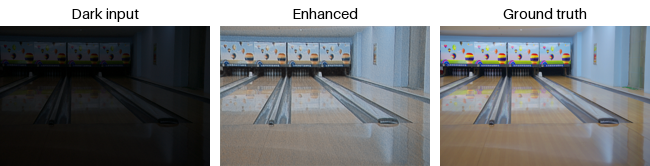

# Riddick — low-light image and video enhancement

A PyTorch project for brightening images shot in the dark, built from
scratch as a learning exercise. The end goal is a camera that sits
outdoors at night and enhances its feed live.

Published architectures are never adopted mid-phase — each phase reaches
its own best result through self-built, measured changes, and a published
model appears only as the comparison point at the end.



*A LOL test image enhanced by an early Phase 1 model. More results in
[`VISUAL_PROGRESS.md`](docs/VISUAL_PROGRESS.md).*

---

## Quickstart

Works on Windows, macOS and Linux; uses an Apple Silicon or NVIDIA GPU
when there is one, otherwise the CPU.

```bash
pip install -r requirements.txt

# 1. Training data: download the LOL archive from Kaggle (link under Dataset), then
python scripts/get_data.py path/to/archive.zip

# 2. Train the Phase 2 model (~1 hour on a GPU; add --epochs 2 --image-size 64 for a quick test)
python scripts/train_unsupervised.py --epochs 150 --spatial-weight 1.0 --color-weight 1.0 \
    --tv-weight 40.0 --exposure-target 0.45 --checkpoint-dir models_p2

# 3. Score it, then enhance your own night photos
python scripts/evaluate.py --curvenet --checkpoint models_p2/model_epoch150.pth
python scripts/inference.py --curvenet --checkpoint models_p2/model_epoch150.pth \
    --input my_photos/ --match-input-brightness 0.0496 -o outputs
```

No GPU? [`scripts/colab_train.ipynb`](scripts/colab_train.ipynb) runs the
same steps on a free Colab GPU.

---

## Where it stands

| | `eval15` *(tuned against)* | `lolv2_test` *(clean, never tuned against)* |
|---|---|---|
| **Phase 1 — supervised** (`models_expjitter`) | 16.95 / 0.7462 | **19.81 / 0.7881** |
| Phase 1 runner-up (`models_noise_baseline`) | 19.29 / 0.7847 | 19.16 / 0.7999 |
| **Phase 2 — unsupervised** (`models_seedcheck_s1`) | 18.21 / 0.6201 | 17.69 / 0.6005 |

*PSNR / SSIM. For reference, published KinD reports ~20.4 / ~0.80 and
Zero-DCE ~14.86 / ~0.56 — but see the caveat below before comparing.*

**Multi-frame merging** is the largest single effect in the project:
**3.55x less noise** from 72 real frames, with **no loss of detail** (edge
profile unchanged) and effective bit depth rising from **7.8 to 12.0
bits**. It runs **live at ~45 fps** (960x540).

---

## The three findings that mattered most

**1. The benchmark was partly measuring its own tuning.**
Roughly 20 hyperparameter decisions were all selected by maximising the
same 15 `eval15` images. When a clean held-out set was finally spent, the
ranking **inverted**: the checkpoint that scored *worst* on `eval15`
(16.95) scored *best* on data nothing had been tuned against (19.81), and
was the only one that improved rather than dropped. What had looked like
a 2.34 dB quality loss was overfit being given up.

**2. The real-photo failure was input covariate shift, not the model.**
LOL's training inputs average 0.0496 brightness; real phone night photos
average 0.2071, and the ranges barely overlap. The model applied the
curve it had learned for near-black input and overshot ~50%, blowing out
highlights. One line of input scaling took blown-out pixels from 2.88% to
**0.00%** with no retraining — superseding five earlier rounds of
fine-tuning that had been spent re-calibrating around it.

**3. Merging is capped by the camera, not by physics.**
Averaging N frames should cut noise by sqrt(N). It reaches only 3.55x at
N=72 because the webcam's own temporal denoising correlates adjacent
frames (measured ρ=0.62) — an artefact of processed output, not a
property of light. This is the single clearest argument for RAW.

**Four of the last seven experiments failed**, and the failures are kept
in full: noise-aware training made noise *worse*, fewer curve iterations
cost real quality, more iterations looked better on two metrics and was
rejected on visual inspection, and exposure jitter did not transfer from
the supervised model to the unsupervised one — for precisely the reason
it was predicted to.

---

## Next phase: real hardware

Everything remaining is **hardware-blocked, not analysis-blocked.** The
available webcam decides exposure and applies denoising before a single
frame arrives, so every capture landed at 0.15-0.21 brightness — a dim
room. **Near-total darkness is untested, not estimated.** A
simulated-darkness experiment was built and then deliberately deleted,
because it answered a different question.

Three requirements for the next camera, each traced to a measurement
rather than a preference:

| Requirement | The measurement that demands it |
|---|---|
| **Manual exposure / ISO** | Every capture pinned at 0.15-0.21 regardless of lighting |
| **Temporal NR off** | ρ=0.62 capped merging at 3.55x instead of 8.5x |
| **RAW** | 8-bit was a hard ceiling; the photon transfer curve returned physically impossible values |

Planned: **Raspberry Pi HQ Camera** (IMX477) on an existing Pi 2 — the
15-pin connector fits without an adapter. `scripts/pi_capture.sh` is
already written against these three requirements, and `merge.py` reads
DNG. When the sensor arrives the same measurements get re-run to see
which ceilings fall.

---

## Repository layout

```
riddick/     the model and the pipeline - this is the project
scripts/     development tooling: train it, measure it, capture with it
docs/        write-ups
data/        datasets
```

**`riddick/`** — what you would import or ship.

| | |
|---|---|
| `models.py` | the three architectures (two supervised, one zero-reference) |
| `losses.py` | Phase 2's zero-reference losses |
| `merge.py` | multi-frame alignment and merging |
| `pipeline.py` | **the end-to-end chain**: merge → normalise → enhance |
| `dataset.py` `metrics.py` `common.py` | data loading, PSNR/SSIM, shared helpers |

Enhance a burst with the full chain:

```bash
python -m riddick.pipeline --frames burst/ --checkpoint models_x/model_epoch150.pth -o out.png
```

**`scripts/`** — everything you run *while developing*, not part of the
product. `train.py` / `train_unsupervised.py` (one per phase),
`evaluate.py` (PSNR/SSIM against ground truth), `assess.py` (all three
selection criteria at once), `inference.py` (single images, no merge),
`live_enhance.py` (live camera preview), `validate_merge.py` (checks
`merge.py` against theory), `seed_check.py` (noise floor), `get_data.py`
(rebuild `data/`), `capture_burst.py` (webcam burst), `pi_capture.sh`
(Raspberry Pi only, so bash), `colab_train.ipynb`. Everything except
`pi_capture.sh` runs on Windows, macOS and Linux; the camera scripts need
`ffmpeg` installed.

**`docs/`** — [`PROGRESS.md`](docs/PROGRESS.md) is the full experiment log
and roadmap, **start there**. [`RESEARCH.md`](docs/RESEARCH.md) holds the
literature and hardware survey plus the original derivations done on this
project's own data (§9). [`VISUAL_PROGRESS.md`](docs/VISUAL_PROGRESS.md)
shows output images.

**`data/`** — `low/`+`high/` are 1,174 training pairs; `eval15_*` is the
tuning set; `lolv2_test_*` is the clean held-out benchmark, now spent;
`real_night*` are real outdoor night photos for domain-gap checks.
Run `python scripts/get_data.py <kaggle archive.zip>` to rebuild the LOL sets —
they are public data, only `real_night*` is original here.

---

## Dataset

- **LOLv1** — ["Deep Retinex Decomposition for Low-Light Enhancement"](https://arxiv.org/abs/1808.04560) (Wei et al., BMVC 2018), from [Kaggle](https://www.kaggle.com/datasets/soumikrakshit/lol-dataset)
- **LOLv2-real** — ["From Fidelity to Perceptual Quality"](https://arxiv.org/abs/2003.07152) (Yang et al., CVPR 2020), from [Kaggle](https://www.kaggle.com/datasets/alenken/low-light-image-enhancement-datasets)

### Why two evaluation sets, and the caveat on comparisons

`eval15` had ~20 tuning decisions selected against it, so a score there is
partly a measure of its own tuning. `lolv2_test_*` (100 LOLv2-real test
pairs, disjoint from training) was reserved as a clean benchmark and
evaluated **once**, at the end, on a finalised config.

**This does not settle the Zero-DCE comparison.** Zero-DCE's published
~14.86 / ~0.56 is measured on LOLv1's `eval15`, not LOLv2's test split,
so our 17.69 is from a different dataset and is not comparable to it. An
untuned `eval15` figure is no longer obtainable — that set is spent. So
whether this project beats Zero-DCE is **not established**, and not
establishable with the data on hand.
